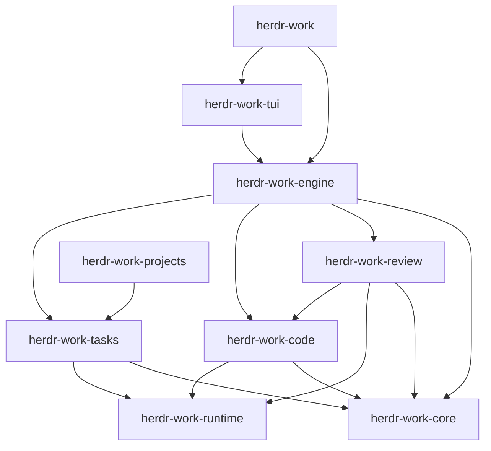

# HerdrWork 产品内部模块整合

用户已确认：来源代码属于 HerdrWork 自身功能，由本项目长期开发、定制和重构。按产品职责组织代码，以一个 Cargo workspace 管理全部生产 Rust package。实际复用已有实现、测试和资源，保留许可证与来源记录。


2026-10-31 补充：生产 workspace 的十个包均位于 `crates/`。进程树监督收在 Engine 内部，显式宿主传输复用 Code 的有界 IPC；Git 身份和索引校验通过 Code 客户端读取，行差异直接使用现有算法依赖。外部审查组件的集成与迁移计划已撤销，见 [内部运行设施决策](../adr/0002-internal-runtime.md)。

## 产品约定

- 产品、主命令、插件分别为 HerdrWork、`herdr-work`、`jtblink.herdr-work`。
- 数据路径优先级为 `--home`、`HERDR_WORK_HOME`、`~/.herdr-work`。不读取 `WORKDESK_*`，不自动发现或迁移旧目录；不提供旧命令、旧收据、旧锁或旧插件数据导入入口。
- 不因去掉兼容而删除用户现有文件。新安装仅管理 `herdr-work-install.json` 声明的当前名称；遇到无有效收据的同名文件拒绝覆盖。正常安装失败恢复与当前名称的安装回滚保留。
- GitHub Issues 是唯一实时任务状态来源；旧父规格及已关闭任务保留历史证据。新增规划见[实施索引](../plans/internal-modules/README.md)。

## 核实的耦合点

| 当前位置 | 当前行为 | 整合时必须处理 |
| --- | --- | --- |
| `crates/herdr-work-engine/src/tasks.rs` | 前台任务操作启动后端 CLI，传目录/托管环境并解析 JSON | 迁为产品 Tasks Rust 接口；后台进程保留独立生命周期 |
| `crates/herdr-work-projects`、`crates/herdr-work-task-*` | 原 CLI 库合入 worker，四个底层实现已纳入根 workspace/锁文件；内部沿用 sw 模块别名 | 后续切断任务业务对旧看板/Web 的依赖，整理为 Tasks |
| Projects core/flow | 含 Ratatui、宿主调用、环境、格式化与业务流程 | 不能将其标成已经纯化的领域模块；分阶段移交 UI 与运行设施 |
| 来源资源和测试 | 有相对 `include_str!`、`include_bytes!`、`CARGO_MANIFEST_DIR` 与原 CLI fixture | 移动时更新资源定位及测试入口，记录保留/迁移/移除的理由 |

## 最终目录与职责

目标为九个有实际职责的 crate。新增 crate 需包含实现与行为检查；此处的目录是规划，不创建空壳占位。

```text
Cargo.toml                         唯一生产 workspace
Cargo.lock                         唯一生产 Rust 依赖锁
crates/
  herdr-work-core/                 跨模块领域标识、执行身份和共享契约
  herdr-work-runtime/              有界进程执行、Herdr socket/pipe 传输
  herdr-work-tasks/                任务存储、attempt/run、状态推进、委派、keeper
  herdr-work-code/                 文件树、Git 读写、Diff 与快照校验
  herdr-work-review/               评论、草稿、批次、发送状态与恢复
  herdr-work-engine/               应用用例、工作上下文、跨模块协调
  herdr-work-tui/                  唯一终端、活动栏、视图、输入和语法着色
  herdr-work/                      主 CLI 与依赖组装，bin = herdr-work
  herdr-work-projects/             后台入口，bin = herdr-work-projects
docs/
  architecture/                   当前架构
  adr/                            设计取舍
  provenance/                     来源基线、许可证索引、模块迁移记录
  plans/internal-modules/         规格、任务草案和 GitHub 链接
scripts/                          根构建、检查、安装与归档编排
```

`docs/provenance/` 保存文字记录和必要许可证索引，不参与编译，也不保存另一套可运行源码。被移动的源码使用 Git rename/diff 追踪；原版权、许可证文件及资源许可随相应模块保留。原始导入 commit 和 Git 历史作为追溯依据，不将 `upstream/`、`vendor/` 或 `components/` 作为最终生产源码容器。

### 模块接口

| 模块 | 调用者需要知道 | 实现内负责 |
| --- | --- | --- |
| Core | Task/Execution/Review/目标身份等共享值；不包含 I/O | 稳定 ID 和纯契约，不吸收各模块全部内部类型 |
| Tasks | 显式配置打开目录；查询、创建、委派、停止、调度和 hook；完成/拒绝/待核对结果 | 原任务格式、attempt/run、任务锁、launcher、Agent caller/report、keeper 心跳与回合流程；不暴露原 UI 或原插件安装器 |
| Code | 显式 worktree、文件/比较范围、操作计划和预期指纹；快照与操作结果 | 原 Tree、SCM Git、审查 Diff 实现；路径和实例验证、Git 写串行及执行前重查；内部可保留不同读取策略 |
| Review | 固定执行目标/快照、评论版本、准备/发送/核对动作及持久状态 | 原评论格式化和传输语义、草稿、批次、不确定送达、评论并发编辑与恢复；不根据最近焦点选目标 |
| Engine | 当前产品用例及工作上下文 | 任务/代码/审查联动、选择与 epoch、跨模块调度；不复制状态机或变为全部实现的容器 |
| TUI | Engine 命令、快照和结果 | 终端所有权、焦点、视口、布局、活动栏、模态输入、着色；绘制不做文件或网络 I/O |

接口应隐藏模块内部的存储、命令顺序和原来源类型。优先具体类型与小接口；生产传输和私有测试宿主等确实变化的位置才引入 adapter，不为每个函数添加 trait 或建立通用插件容器。



TUI、CLI 也可读取 Core 契约；图省略该两条边。Core 不依赖 I/O 模块；Runtime 不依赖 Tasks/Code/Review/Engine/TUI；业务模块不依赖 Engine/TUI；Code 不依赖 Review。模块内部保持私有，避免继续用跨 crate 的大范围 glob re-export 形成隐式依赖。

### 源码复用与运行进程

先迁移再调整接口，保留原任务、SCM、Diff 算法和可观察语义。来源测试按实际产品接口迁移，不能以新同名实现或模拟成功结果替代复用。

前台任务读写、文件/Git 和审查由 Engine 直接调用内部 Rust 模块。`herdr-work-projects` 缩为 Tasks 的后台入口，负责 keeper、launcher、Agent report 和 hook 等需要独立生命周期的命令；复用同一 Tasks 实现，不形成第二套业务流程。工作台退出不停止既有 Agent，暂停自动调度和停止 Agent 仍是不同操作。

统一 workspace 不要求把 keeper 放入 TUI 线程，也不要求本轮合并两个可执行文件。产品只发行这两个入口，不发行原三个插件的独立 UI、安装器或自动更新器。后台子进程接受明确目录、endpoint 与调用上下文；主进程不通过全局 `set_var`/`set_current_dir` 切换资料或仓库。

## 两阶段迁移

### 第一阶段：统一工程，保持行为

先登记当前所有 package、生产入口、相对资源、测试及功能副作用。机械迁移采用以下映射，以保留可审查的源码移动记录：

| 来源 package | 过渡期根 workspace 成员 |
| --- | --- |
| 四个现有产品 package | 原 `crates/herdr-work-*` 位置 |
| Projects 根 CLI | `crates/herdr-work-projects` |
| `sw-core` | `crates/herdr-work-task-data` |
| `sw-flow` | `crates/herdr-work-task-flow` |
| `sw-board` | `crates/herdr-work-task-board`，仅过渡承接原 CLI 依赖 |
| `sw-web` | `crates/herdr-work-task-web`，仅过渡承接原 CLI 依赖 |
| Sidebar lib | `crates/herdr-work-code` |

该阶段是十一成员的过渡布局，还没有 Runtime crate，Code 暂时仍依赖 Review 的原运行实现。测试需明确捕获这些暂态例外，最终交付必须消除。内部 module 路径可短期保留以减少机械 diff，但不添加旧用户命令/配置别名。

合并 workspace 继承字段、锁文件和 features；保留 Projects `serde_json` 的排序/浮点语义及原平台依赖。不同版本的 `toml` 等允许并存，不把依赖去重、升级依赖和业务重构混进移动步骤。来源 crate 的测试资源和必要 fixture 随迁；旧插件的独立宿主场景先分类，再用私有 fixture 覆盖产品调用路径，不自动连接用户 Herdr 会话。

### 第二阶段：形成产品模块

1. 提取 Runtime 的有界进程和宿主传输，迁移实际调用者，解除 Code 对 Review 的运行设施依赖。
2. 将 task-data/task-flow 中实际任务实现内聚到 Tasks。CLI 解析与持久化状态机分开，前台 Engine 走 Rust 接口，后台入口复用 Tasks；看板/Web 的 UI 工具与任务依赖逐项分离。
4. Review 接收草稿、批次及发送恢复逻辑；着色和绘制移入 TUI。Engine 保留跨模块执行绑定，Review 发送前仍校验固定目标与评论版本。
5. 清理过渡 task-data/flow/board/web 成员和原插件入口；仅删除有调用图、测试迁移和功能范围依据的代码。完成最终九成员布局和来源文档迁移。

每项只迁移一条生产调用路径，旧实现移走后由新位置承接调用。避免双份数据写入、两套任务真相、永久转发层和长期并存的同名源码。

## 默认工作区布局

采用原 Sidebar 的 Explorer/Source Control 导航、Git 状态颜色和选择样式。产品保持单 TUI：活动栏 → 可切换侧栏 → 文件/差异内容区 → 底部状态与操作提示。默认 Files/Explorer；Tasks 不持续占用默认左栏。File Tree 和 SCM 继续调用已复用的真实 Tree/Git 实现。

```text
HerdrWork | 当前仓库
2 Files  | EXPLORER             | Preview · src/main.rs
         | ▾ src                | 文件内容
3 Git    |     main.rs M        |
         |   Cargo.toml         |
1 Tasks  |                      |
4 Review |                      |
任务状态 · 文件数量 · Git 修改数量
当前结果 / 错误与操作提示
```

切换 Git 后，侧栏改为分支及 Staged/Changes 列表，右侧显示 Diff。打开 Git Diff 不改变 SCM 的 `s` 暂存语义；切入 Review 焦点后才使用其评论/发送快捷键。

Files 支持目录展开、文件预览与 Git 标记；SCM 分 Staged/Changes，展示分支，支持真实 Diff、暂存、取消暂存和提交；Review 保留评论/发送工作流。保留 `1 Tasks / 2 Files / 3 SCM / 4 Review`，支持活动栏与列表点击、Tab 焦点、预览独立滚动；80 列仍显示侧栏和内容，更窄时按焦点显示一个区域。输入、resize 和异常退出均由唯一终端所有者处理。原 Sidebar 的搜索、编辑器、分支管理和额外菜单尚未全部接入，本轮不能据此宣称完整复刻 VS Code 或开放这些能力。

## 验证与交付标准

- 机械迁移前建立当前产品接口的可复现基线，并逐项列出来源测试是否实际运行。保留 Task/Attempt/Execution/Run、caller/report、锁/心跳、回调隔离和 UI 退出语义。
- 每个业务切片提供真实 Git 仓库/文件系统或私有宿主 fixture 的检查；覆盖路径/目录实例/index/content 变化、过期结果、评论编辑、发送 Unknown、取消/超时、子进程后代及终端恢复。
- UI 检查分别等待 Tasks 和 Files/Git 就绪；实际经过默认 Explorer、鼠标导航、预览、stage/unstage、Diff、创建任务、80 列和退出。任务后端错误不能替代文件状态，晚到预览不能覆盖当前文件。
- 生产 Rust 源码均在 `crates/`，根 `cargo metadata` 可列出；只有一份生产 `Cargo.lock`，构建脚本不再跨 workspace 编译，不再引用 `upstream/` 或来源独立 target。测试/嵌入资源和许可证完整。
- macOS/Linux 构建、测试全部适用成员；Windows 共享同一 workspace/lock，但明确排除 Unix-only Tasks/worker 等不支持目标，测试其产品入口返回不可用原因，不创建空后端冒充支持。实际排除表随过渡布局更新，最终为 Tasks 与 worker；文件/Git/审查仍原生检查。
- 三平台 CI 各自真实构建、归档、隔离安装和校验；发布必须另行按正式发布流程固定 SHA、生成附件并验收。本次规划不触发新 Release。
- 默认环境、资料和安装从新项目开始；负向测试证明旧 `WORKDESK_*`、旧标记和旧命令没有行为。现有个人目录和已发布历史附件不自动删除。

## 决策与资料

- [ADR-0001：作为产品内部模块维护来源代码](../adr/0001-first-party-workspace.md)
- [当前来源与实际补丁](../upstream/source-map.md)，迁移完成后由任务移至 `docs/provenance/`
- [Cargo workspace 约定](https://doc.rust-lang.org/cargo/reference/workspaces.html)

来源 Git 哈希只表示导入起点，HerdrWork 的实际代码以本仓库提交和产物 manifest SHA 为准；持续定制不受该哈希限制。后续按明确功能需求选择性引入来源改动，不自动覆盖本地实现。
