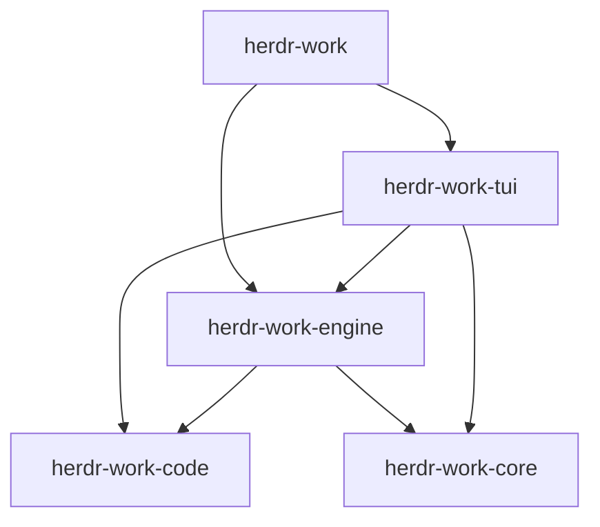

# HerdrWork 产品内部模块整合

2026-11-01 调整：任务管理、看板和调度后台退出产品，原九模块目标撤销。当前范围以 [ADR-0003](../adr/0003-remove-task-backend.md) 为准。来源实现继续作为产品内部代码维护，保留其版权、许可证和行为测试。

## 当前结构

根 workspace、Cargo.lock 和 target 统一管理五个生产 package，全部位于 `crates/`：

| 模块 | 职责 |
| --- | --- |
| `herdr-work-core` | 执行、目标、审查、评论批次等共享契约，不执行 I/O |
| `herdr-work-code` | 复用 Sidebar 的文件树、搜索、编辑、Git、Diff、预览与宿主布局实现 |
| `herdr-work-engine` | 应用用例、显式 Agent 绑定、评论持久化与发送恢复、Git 操作日志、有界进程与宿主传输 |
| `herdr-work-tui` | 唯一终端与输入循环、视图、焦点、模态交互及异步结果应用 |
| `herdr-work` | 主 CLI、依赖组装及插件内部入口；唯一发行程序 |

Code 的 `reference-ui` 用于显式运行来源界面测试，不参与生产发布。进程监督与宿主连接保持内部模块，见 [ADR-0002](../adr/0002-internal-runtime.md)。原始导入基线、版权和补丁见[来源映射](../upstream/source-map.md)。

## 产品边界

- 产品、主命令、插件分别为 HerdrWork、`herdr-work`、`jtblink.herdr-work`。
- 数据目录依次选择 `--home`、`HERDR_WORK_HOME`、`~/.herdr-work`；不读取旧名称的环境或数据，不自动删除用户目录。
- 独立插件的配置、资料、窗格和生命周期不由本产品接管。预览仅停车安全的自有工作子树，没有安全区域时使用独立预览标签页。
- 默认 Sidebar 直接托管迁入的 Explorer/SCM，`ui --standalone` 提供文件、搜索、Git 与审查的完整布局。两种模式均保持单终端与唯一输入循环。
- CLI 审查与聚焦按工作目录及可选 `--pane` 绑定 Agent；发送前校验固定目标、执行身份和评论版本，不按最近焦点选目标。
- 异步结果携带上下文 epoch、请求号和工作目录实例；过期读取不能覆盖新选择。Git 写入前重新验证 HEAD、索引和文件指纹。
- 审查 Sending 恢复为 Unknown，未知送达不能自动重发。Git 日志继续支持 `reconcile`，必须提供核对证据才可解决未知操作。
- 安装器只覆盖有当前产品收据的自有程序，保留失败恢复、重装、回滚与卸载；独立插件和用户数据保留。

## 验证与交付

使用根 `cargo fmt --check`、`cargo test --workspace --locked` 与 Python unittest。真实 Git、文件系统、私有宿主及 PTY fixture 验证浏览、搜索/替换、编辑冲突、stage/unstage、Diff、审查发送和终端恢复。

macOS、Linux、Windows 都只打包主程序及仍使用的许可证。三平台分别原生构建、测试、归档、隔离安装后才发布；本机结果不能替代其他平台。历史规格及 Issue 快照保留起草时证据，后续实现不再接续已撤销的任务模块规划。
