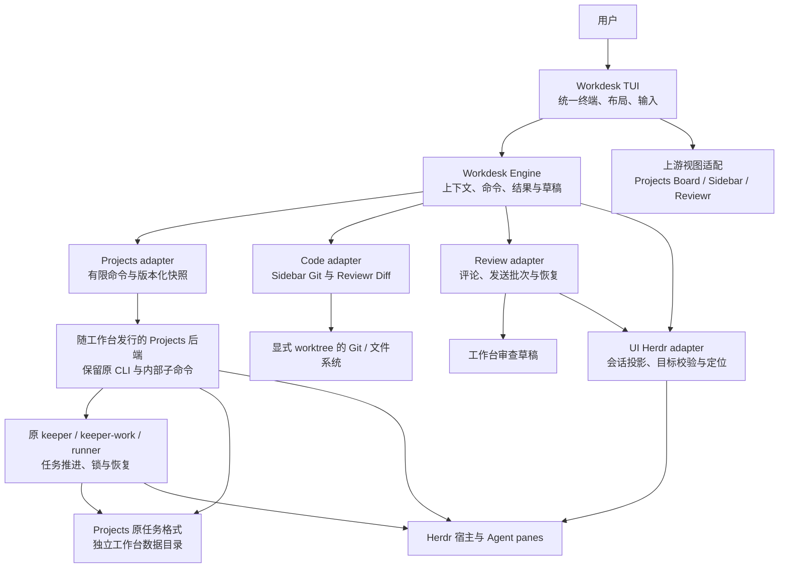
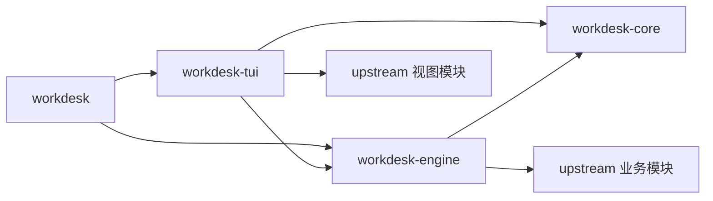

# Workdesk 复用优先架构

## 设计结论与范围

用户已确认复用 Projects、Sidebar、Reviewr 的业务源码逻辑、采用本文架构发布 13 项 GitHub 任务，并指定四个工作台 crate 与 upstream 原结构布局。本文记录已确认的设计；应用实现、工具链及真实会话验收尚未完成。

推荐采用 **一个工作台 TUI + Projects 原有 CLI/keeper 后台体系 + 三个固定版本的源码适配**。保留已有任务流程、Git 实现、Diff 和评论能力，新代码集中处理工作上下文、跨模块联动、输入与布局，以及发送和恢复规则。

复用要求是实际编译、调用并维护上游业务实现：Projects 的 `sw-core/sw-flow/sw-board`、Sidebar 的 `tree/git/viewer`、Reviewr 的 `diff/model/world/ui`。任务侧采用 CLI 仅为保留进程生命周期，其后仍执行导入的原业务代码；文件和审查侧直接以 Rust lib/module 接入。不能另写一套同名流程后称为复用，也不能只组合三个原插件的 actions 作为交付。

首版面向本机 macOS/Linux，连接本地 Herdr。Agent 在 Herdr 原生 pane 中运行，工作台定位并聚焦 Agent。跨机器编排、Projects Web UI、forge PR 面板、内嵌 Agent PTY 不纳入首版验收；保留来源代码不等于承诺这些能力已兼容。

第一条可交付路径是：已有任务 → 明确的一次执行 → 该 worktree 的 Diff → 行级评论 → 向对应 Agent 回填审查文本。随后接入完整文件树、SCM 写操作和从工作台发起任务。

## 源码与证据

2026-10-18 已重新下载下列固定 commit 的源码归档至本仓库的 `reference-plugins/`，检查归档根目录、Cargo 清单和 LICENSE，并重新阅读本文涉及的关键实现。参考目录被 Git 忽略；本次未构建上游或启动 Herdr 会话。

| 上游 | 固定版本 | 本次确认的复用位置与限制 |
| --- | --- | --- |
| Projects | 1.2.2 / `92a2813be9a7c2f8cda737f6b78ed21e8413c3ce` | `sw-core`、`sw-flow`、`sw-board` 已存在；CLI 支持 JSON 输出；board reducer 返回 effects；keeper 是锁、心跳和工作子进程组成的后台体系。[P1] [P2] [P3] |
| Sidebar | 0.15.1 / `081ed133f3faa377438b51ce435fe8a87c439593` | lib 已导出 tree/git/viewer 等；Explorer/SCM App 在二进制模块；多个改根路径调用全局 `set_current_dir`。[S1] [S2] |
| Reviewr | 0.46.0 / `859dd5b11a5280fe282de56b52378b20a54fa10a` | lib 导出 app/diff/model/world/ui；App 仍同步执行 export；发送成功后才清评论，聚焦失败不撤销发送成功。[R1] [R2] [R3] |

Projects 的 `Task` 实际是动态 JSON；其 attempt 是可并行竞争的任务候选，run 是一次 Agent turn/reviewer 工作片段，二者不能直接重命名为工作台 Execution。[P4] [P5] [P6]

以下架构是实施依据。当前实现使用四个自有 crate、上游完整源码、单 TUI 与 Projects 独立后端；实际调用及必要补丁见 [源码映射](../upstream/source-map.md)。构建目标固定 Rust 1.99.0。Windows 发行包仅提供原生文件/Git/审查能力，Projects 后端保持 Unix 平台范围。详细交互与性能条款为设计目标，不能据本文推断已人工验收。完整获取说明见[参考插件源码](../reference-plugins.md)，前期比较见[技术调研](../research/workbench-refactoring-plan.md)。

## 运行结构



### 保留 Projects 后台体系

工作台分发两个运行入口：`workdesk` 是新 TUI；另一个是固定版本适配后的 Projects 后端。后端保留原 CLI 的内部命令约定，包括 keeper、keeper-work、runner、Agent hook 和现有生成脚本所需入口。可执行文件最终名称在构建切片中验证，不先强制合为一个 executable。

这是为了保留源码中的真实约束：`bin()` 根据当前可执行文件定位自身，keeper 会再次启动自身的子命令，Agent 也会获得指向后端的启动路径。只把 flow 链进工作台后改掉程序入口，会破坏这组调用。[P3] [P7]

首版不新增通用守护进程或调度器。Projects adapter 通过参数数组启动后端，复用已有 `--json` 命令；缺少完整任务/执行快照时，在后端补充范围有限的版本化查询命令。快照查询只读，缺失的工作台关联由显式 reconcile 命令修复。禁止由 UI 拼 shell 命令或直接改 task JSON。

源码中 CLI 在分发任务命令前运行旧安装接管、目录迁移和设置处理，完成任务命令后还运行 housekeeping；board 的 `Data::load` 会清理已完成 dispatch 并消费部分通知。因此只读快照不能直接调用完整 CLI list 或原 loader，需复用其中实际的任务读取/投影函数，绕开写入和通知消费。[P8] [P9]

任务后台由原 keeper 体系维持：关 UI 后已启用的后台调度继续；UI 不再运行 board 原来的任务推进 tick。停止调度、关闭 UI、停止 Agent 是不同动作。停止调度只停止后续自动推进，不隐式杀死已有 Agent；显式停止执行继续调用 Projects 原流程。

### 按业务数据划分写入所有者

| 数据或动作 | 所有者 | 并发规则 |
| --- | --- | --- |
| Projects 任务、attempt、run 与自动化 | Projects 后端进程体系 | 保留上游 task/tick/keeper 锁；CLI、hook、worker 都通过原修改入口，不宣称只有一个 OS 进程写入 |
| 工作台 Execution 关联记录 | Projects 后端的适配模块 | 在任务相关锁下维护 sidecar；UI 仅查询/发送关联命令；不复制一套任务阶段 |
| 当前选择、焦点、视图状态 | TUI 主循环 | 同一 state root 首版只允许一个可写 TUI；重复打开定位已有实例，无法确认身份时报告冲突 |
| 审查草稿、批次与发送结果 | Engine 的 Review 模块 | UI 发命令，Review 模块负责持久化；切视图不销毁会话；后台完成结果先入业务状态再更新界面 |
| Git 写操作 | Engine 的 Code 模块 | worktree 操作串行；涉及共享 refs/仓库配置的操作使用仓库级协调；外部 Git 不受工作台锁控制，执行前重查条件 |

UI Herdr adapter 管理供视图共享的会话投影；Projects 后台保留其调度所需连接。两者共享身份契约，不要求跨进程共用一条 socket，也不在首轮重写所有上游 Herdr 调用。

## 源码接入与模块组织

用户已确认目录采用“工作台自有 crate 与来源源码分开”的结构。根 workspace 只管理四个自有 crate；三个来源项目放入正常跟踪的 `upstream/`，保留原始仓库内部结构、Cargo 清单、资源和测试。下载的 `reference-plugins/` 继续作为只读对照，不参与正式构建。

```text
Cargo.toml                         工作台根 workspace：显式列出四个自有成员
Cargo.lock                         工作台应用及其 path dependencies 的依赖锁
crates/
  workdesk-core/
    Cargo.toml
    src/                           领域标识、上下文、命令/结果契约
    tests/                         该 crate 的公开行为测试，按需添加
  workdesk-engine/
    Cargo.toml
    src/                           用例编排、来源适配、后台工作与恢复
    tests/
  workdesk-tui/
    Cargo.toml
    src/                           终端所有权、输入、布局与视图适配
    tests/
  workdesk/
    Cargo.toml
    src/main.rs                    薄入口：解析参数、组装依赖、启动和退出
    tests/                         CLI 和跨进程场景的集成测试
upstream/
  herdr-projects/                   原根 Cargo/src/tests/crates 等结构保留
  herdr-sidebar/                    原根结构与 plugins/herdr-sidebar 保留
  herdr-reviewr/                    原根 Cargo/src/tests 等结构保留
docs/
  architecture/                    当前架构
  plans/                           规格、发布快照及 GitHub 索引
  research/                        固定版本调研证据
  upstream/                        来源、许可、补丁和升级记录
scripts/                           经过验证的构建、检查与打包编排
.github/workflows/                 平台检查，随实现添加
reference-plugins/                 完整参考副本，被 Git 忽略
```

这是一份实施目录规范，尚未创建工作台源码、空 crate 或 CI 占位文件。每个 crate 是一个实际 Cargo package，内部遵循 `src/lib.rs`、`src/main.rs`、`tests/` 等标准位置；不在虚拟 workspace 根目录堆放没有测试 harness 的 Rust 集成测试。命名使用小写短横线；Rust 模块和函数使用 snake_case，类型使用 PascalCase。

### 四个自有 crate 的职责与依赖

| crate | 负责 | 不能承担 |
| --- | --- | --- |
| `workdesk-core` | 跨模块领域标识、执行身份、上下文、命令/结果与稳定错误语义 | 终端、宿主连接、Git 子进程、磁盘读写和上游 App 状态 |
| `workdesk-engine` | 工作流编排、Projects/Code/Review/Herdr/存储适配、异步结果判定、恢复 | 绘制、原始键盘事件、终端初始化；重新实现已有任务/Git/Diff 业务算法 |
| `workdesk-tui` | app state、事件路由、布局、焦点、终端生命周期和上游视图接入 | 修改任务文件、直接调用上游业务写入口、自己推断执行者身份 |
| `workdesk` | 参数/配置解析、日志初始化、依赖注入及退出码 | 任务推进、Git 操作和评论发送规则 |



依赖只沿上述方向；core 不依赖上游，engine 不依赖 tui，上游不反向依赖工作台。TUI 因复用 `sw-board` 等 lib 而传递链接 flow 不等于获准直接执行其写操作；所有 effects 经过白名单映射，业务命令统一进入 engine。后端 CLI 仍从 Projects 原入口构建，以保留自启动和 keeper 内部命令契约。

Engine 内部按 `context`、`tasks`、`code`、`review`、`host`、`storage`、`jobs` 等实际职责组织普通 Rust 模块；领域用例与其适配集中在对应模块，公开面只暴露调用者需要的命令、快照和结果。不先拆一层层 service/repository/manager，不建立通用插件容器，也不为每个来源函数新增 trait。需要替换实现或独立验证时，再在该模块内部设置小接口。

TUI 内部按 `app`、`event`、`layout`、`terminal`、`views` 组织；Tasks/Files/SCM/Review 的来源桥接靠近对应 view。输入先转换为工作台动作，后台结果再投影为视图状态；`render` 不进行 I/O。来源错误在 engine 归一为稳定分类，tui 只负责呈现可操作反馈。

crate 间通过小型公开接口协作；模块内部默认私有或 `pub(crate)`。仅共享真正跨模块的模型，不建设含大量无关函数的 utils/common crate。是否增加 crate 由实际依赖、独立变化和测试需求决定，不为目录整齐继续拆层。

### 保留上游结构的 Cargo 与版本策略

根 workspace 显式声明四个成员，并排除 `upstream/` 中的来源项目被自动吸收。通过 path dependency 引用需要的上游 lib，使用来源已有 workspace 解析其继承字段；不删除 Projects 的原 workspace，不提升 Sidebar 嵌套 package，也不移动原 CLI 的资源或测试入口。

根 Cargo.lock 锁定工作台及其直接/传递 lib 依赖；独立构建 Projects 后端仍使用其原 workspace/Cargo.lock。统一构建脚本编排两者并输出一个工作台发行清单，分别记录锁文件及来源 commit。这里的统一是目录约定、构建入口和依赖治理，不宣称所有来源共用一份锁文件。首项任务实际验证跨 workspace path dependency 与后端构建，失败时记录兼容问题，不能暗中改成移动源码或降低 MSRV。

保留上游 package/lib 名称、版本和原始资源路径，工作台四个 package 使用自身版本。公共依赖在兼容时约束；来源间不同 toml 等依赖允许并存，不为去重而重写解析逻辑。上游补丁限于经任务定义的接入点，每个补丁记录来源、目的、行为差异和测试。

Projects 的 core/flow 当前含 Ratatui 等依赖，并非纯领域库；首轮保留其真实组织，不为了宣称分层而拆解业务。Reviewr 声明 Rust 1.97，Sidebar 声明 1.89，三者使用 Ratatui 0.30。先验证工具链、锁文件和渲染类型兼容性，不直接降低 MSRV，也不提前声称可以同屏链接。[P1] [S3] [R4]

## 三个项目的复用方式

| 来源 | 首轮保留 | 必要适配 | 工作台新增 |
| --- | --- | --- | --- |
| Projects | 任务格式、状态推进、attempt/run、委派/停止、锁、keeper、board state/update/view | 插件身份和后端路径注入；只读快照；effects 桥接；关闭原自更新、自动开原看板和向 Sidebar 推送的展示副作用 | Task/Execution typed 投影、上下文关联及跨视图选择 |
| Sidebar | tree/ignore、Git discover/status/stage/unstage/commit、viewer/语法着色、原有 SCM 语义 | Explorer/SCM 导出 `Rect` 内绘制与输入入口；消除所有嵌入路径的全局 CWD；替换 pane/heartbeat/ensure/update 副作用 | 从工作台接收 worktree，返回选择和 Git effects，与 Review 共享失效通知 |
| Reviewr | diff/model/comment 格式、比较基线、world/watch/search 策略、渲染和进程取消能力 | `App` export 拆成批次 effect；渲染接受指定区域；worker 由工作台调度；替换自动选 Agent、pane 识别及原终端循环 | Execution 目标校验、草稿持久化、未知送达状态及上下文隔离 |

不将原始三个 App 直接当 widget，也不同时调用三套 `run()`。适配时先保留局部 state 和渲染实现，拦截宿主、文件写入和终端副作用，再逐个移交工作台。首版未开放的原快捷键和菜单必须禁用或隐藏；未知 effect 明确报“不支持”，不能悄悄直通上游执行。

每个实现任务需提供复用证据：来源 commit/模块、仍被实际调用的原逻辑、必要适配点、对应上游行为测试及结果。不以复制了多少文件或相似行数证明复用；若原逻辑确实无法保留，先记录原因、行为差异和替换范围，不能在实现中自行扩大为重写。

### Git 与 Diff 允许不同实现共存

Sidebar 负责 SCM status 和用户主动的 stage/unstage/commit；Reviewr 保留其审查基线、Diff 读取和临时 index 等专用策略。共享的是显式 worktree、文件选择、变更通知与刷新代数，不强迫两套实现立刻合并为一套 Git 库。

每个 worktree 由一个刷新协调器接收文件和 Git 变化。原 Reviewr watcher 可作为变化来源，其他视图消费通知，不各自新开全仓扫描。变更失效 SCM、树装饰、审查快照；读取按各自语义执行，避免把一份 SCM 数据误当作审查 Diff。

## 工作上下文与执行映射

`TaskId` 保留 Projects 源 ID 的稳定映射；`ExecutionId` 标识一次工作台跟踪的执行实例，并关联源 task、可选 attempt、委派实例、worktree 与 Agent 身份。一个 Execution 可以含多个 Agent turns；原 run 不直接等同 Execution。

任务支持多次 Execution，来源中并行的 attempts 保持独立。工作台不把它们压成“当前唯一 Agent”。列表展示多个候选，用户选定具体执行后才允许回发；同一 Agent 同时关联多个候选或一个 worktree 存在多个活跃执行时，标记冲突并暂停自动推断。

Execution 关联由后端适配模块存入独立 sidecar，源任务状态仍以 Projects 数据为准。关联包含持久化的工作台 ID、源标识及当前宿主快照的绑定证据；单靠时间戳或路径不足以证明身份。来源无法唯一恢复时，状态为 unresolved，用户显式重绑后才允许发送。

Host 身份包含 endpoint、session、pane、terminal 及可验证的进程实例信息；workspace/tab 是可变位置。pane 移动保留可验证的执行身份，terminal 重建或宿主重启则重新解析。工作区标题和最近焦点都不构成发送依据。

Worktree 记录 RepoId、Git common dir、规范化根目录及可验证的目录实例信息；删除后同路径重建必须重新发现，不能继承旧发送权限。嵌套仓库、submodule 的 Git 操作以各自根目录为目标。

选择上下文是 UI 的快照：`task + execution + worktree + review + epoch`。用户另行浏览目录时明确展示偏离，并禁止将脱离执行范围的评论直接发送给原 Agent。

### 将异步读取和业务写入分开处理

- 视图读取携带 worktree、输入指纹、刷新 generation、request ID 和 context epoch；只有仍匹配的结果可更新当前视图。同一任务内刷新也要检查 generation，不能只检查 epoch。
- Git、任务和发送等业务操作携带固定目标、operation ID 和前置条件；开始后切任务不改变目标，完成结果更新其原业务记录。epoch 只决定当前页面是否展示提示。
- 取消读取可直接丢弃结果；取消业务操作不等于回滚，无法证明结果时进入需要核对状态。超时后不自动重复委派、commit 或发送。
- 队列有容量和截止时间。可合并的刷新只保留最新请求；业务结果不能被刷新挤掉。复用 Reviewr 的 wake/worker 机制和上游原生线程，首版不额外引入 Tokio。

## 审查会话与发送契约

Review 绑定 Execution、worktree、比较范围及不可变审查快照。复用 Reviewr 的文件、side、行范围、snippet 和 revision，额外记录本次读取的内容指纹；工作目录内容也需要指纹，不能只用 HEAD 标识。[R5]

Agent 改动文件后，旧评论保留原锚点，标记 stale。重新定位评论需要用户确认；首版 stale 评论不允许自动发送，用户可刷新并重新确认锚点。切任务或关 UI 后按 Review 身份恢复草稿，不按当前文件路径重新归属。

发送流程：

1. 固定待发送的 comment IDs/versions、文本快照、Execution 和目标身份，生成 BatchId。发送期间新增或编辑的评论不进入该批次。
2. 先持久化 prepared，再核对宿主当前 terminal/Agent、执行绑定和 worktree。发送调用前持久化 sending；不满足前置条件就停止。
3. 使用 Reviewr 的格式化与 Herdr 发送实现。成功只表示宿主接受了回填请求，不代表 Agent 已执行意见；是否需要人工提交输入遵循上游实际行为并在真实会话中验收。
4. 确认回执后持久化 delivered，只消费该批次中版本未被修改的评论；聚焦失败只显示警告。明确未送达则保留草稿并允许重试。
5. 可能已送达但无回执，或进程在 sending 后崩溃，恢复为 unknown；保留批次与草稿并阻止自动重发。先由用户核对目标输入/会话，确认未送达后才允许显式重试。

批次 ID 可用于工作台本地去重，不假定 Herdr 提供服务端幂等，也不承诺 exactly-once。重新核对和真正发送之间仍有竞态；只有宿主支持目标实例校验时才能原子消除，否则检测到不稳定绑定时拒绝发送，并保留该限制的验收记录。

Reviewr 原 export 日志包含格式化后的完整评论文本；适配发送路径时移除这类正文日志，仅记录批次、脱敏目标标识、结果与耗时。复用发送代码不意味着照搬原日志副作用。[R2]

## 界面与持久化

一个终端所有者负责 raw mode、alternate screen、输入、鼠标、resize 和异常恢复。视图只操作分配的 `Rect`。Projects 原绘制若使用整屏坐标，可先在局部 Buffer 绘制后映射；Sidebar/Reviewr 同样需要鼠标坐标和弹层裁剪适配。

首版布局为任务/执行导航、Files/SCM 切换区、主 Diff/文件阅读区及评论入口；窄屏切为单主视图，任务导航可收起。输入顺序为模态输入、局部视图、全局动作。Agent pane 仍由宿主布局管理，工作台只提供定位和返回上下文。

配置/状态根目录在启动时解析并固定，通过子进程环境显式传给 Projects；运行中不通过 `set_var` 或 `set_current_dir` 切换 profile。工作台数据与原插件默认数据隔离。

| 内容 | 权威来源与恢复 |
| --- | --- |
| 任务、attempt、run | Projects 原数据格式与锁；不建立第二套任务真相 |
| Execution sidecar | 后端维护的关联与历史；来源不充分时保留未知状态，投影可重建但历史不捏造 |
| Review/发送批次 | 版本化工作台文件；原子替换并定义同步落盘策略；恢复时 sending 进入 unknown |
| 树展开、选择、布局 | 按 worktree/Review 身份保存的偏好；损坏可重置，不影响业务状态 |
| SCM/Diff/宿主快照 | 可重建缓存；重启不把旧快照作为当前发送凭据 |

跨文件流程使用先记录意图、再调用上游、再核对结果的方式恢复，不声称几个原子文件组成事务。委派已成功但关联未完成时，重新读取源任务与宿主；不能确定就暂停自动操作，不重新委派。升级、掉电和部分写入场景需要单独验证，不能以 rename 成功代替持久性保证。

## 接入、验证与发行

固定源码 → 构建兼容性 → 已有任务到评论回发 → 文件/SCM → 委派与后台 → 迁移与发行。交互试验嵌入每个切片，先演示真实路径；单 TUI 是本方案的推荐默认，只有实际尺寸、焦点或适配成本验证失败时才重新评估多窗格。

每个切片通过外部行为验证其接口，并保留对应上游测试。重点覆盖两个任务/两个 worktree、并行 attempts、旧异步结果、pane 移动/重建、评论修改与发送交错、未知回执、Git 外部修改、重复 hook、UI 关闭与重启恢复。

首轮构建记录实际 Rust/MSRV、Cargo 解析和每个平台结果；只在分别验收后声明平台支持。性能先测输入响应、大仓库扫描/刷新耗时、空闲唤醒与峰值内存，再设置回归预算。

发行使用一个工作台版本和安装入口，包含新 UI 与固定 Projects 后端；关闭三个来源的下载/自更新和原窗格自动补建路径。保留 MIT 文本与来源，后端内部版本与工作台版本分别可查询。

旧数据导入先预览、备份、复制到新命名空间、核对源 ID，再切换入口；原插件不与新版本共写业务数据。停止旧 hooks 和 keeper 必须是迁移步骤中的显式动作，不能由普通启动顺带执行。回滚恢复原入口及备份，不覆盖用户后续数据。

## 实施门槛与任务衔接

用户已确认 Projects 独立后端、单 TUI 适配、四个自有 crate 与保留原结构的 upstream 布局。仍需实际验证的门槛是：统一渲染依赖、三套视图的局部绘制、源执行与 Execution 的可靠映射、宿主对目标实例和回填结果的保证。

功能规格和任务拆分分别见[首版规格](../plans/workdesk/spec.md)与[GitHub 任务索引](../plans/workdesk/README.md)。所有任务依赖下载后的固定源码，任务发布不代表实现已经开始。

[P1]: https://github.com/eliasstravik/herdr-projects/blob/92a2813be9a7c2f8cda737f6b78ed21e8413c3ce/Cargo.toml
[P2]: https://github.com/eliasstravik/herdr-projects/blob/92a2813be9a7c2f8cda737f6b78ed21e8413c3ce/crates/board/src/board/update/mod.rs
[P3]: https://github.com/eliasstravik/herdr-projects/blob/92a2813be9a7c2f8cda737f6b78ed21e8413c3ce/crates/flow/src/keeper.rs
[P4]: https://github.com/eliasstravik/herdr-projects/blob/92a2813be9a7c2f8cda737f6b78ed21e8413c3ce/crates/core/src/store/tasks.rs
[P5]: https://github.com/eliasstravik/herdr-projects/blob/92a2813be9a7c2f8cda737f6b78ed21e8413c3ce/crates/flow/src/attempts.rs
[P6]: https://github.com/eliasstravik/herdr-projects/blob/92a2813be9a7c2f8cda737f6b78ed21e8413c3ce/crates/core/src/store/runs.rs
[P7]: https://github.com/eliasstravik/herdr-projects/blob/92a2813be9a7c2f8cda737f6b78ed21e8413c3ce/crates/core/src/store/files.rs
[P8]: https://github.com/eliasstravik/herdr-projects/blob/92a2813be9a7c2f8cda737f6b78ed21e8413c3ce/src/cli/mod.rs
[P9]: https://github.com/eliasstravik/herdr-projects/blob/92a2813be9a7c2f8cda737f6b78ed21e8413c3ce/crates/board/src/board/data.rs
[S1]: https://github.com/alexarthurs/herdr-sidebar/blob/081ed133f3faa377438b51ce435fe8a87c439593/plugins/herdr-sidebar/src/lib.rs
[S2]: https://github.com/alexarthurs/herdr-sidebar/blob/081ed133f3faa377438b51ce435fe8a87c439593/plugins/herdr-sidebar/src/scm_app.rs
[S3]: https://github.com/alexarthurs/herdr-sidebar/blob/081ed133f3faa377438b51ce435fe8a87c439593/plugins/herdr-sidebar/Cargo.toml
[R1]: https://github.com/persiyanov/herdr-reviewr/blob/859dd5b11a5280fe282de56b52378b20a54fa10a/src/lib.rs
[R2]: https://github.com/persiyanov/herdr-reviewr/blob/859dd5b11a5280fe282de56b52378b20a54fa10a/src/app.rs#L4979-L5015
[R3]: https://github.com/persiyanov/herdr-reviewr/blob/859dd5b11a5280fe282de56b52378b20a54fa10a/src/export.rs#L165-L195
[R4]: https://github.com/persiyanov/herdr-reviewr/blob/859dd5b11a5280fe282de56b52378b20a54fa10a/Cargo.toml
[R5]: https://github.com/persiyanov/herdr-reviewr/blob/859dd5b11a5280fe282de56b52378b20a54fa10a/src/model.rs
