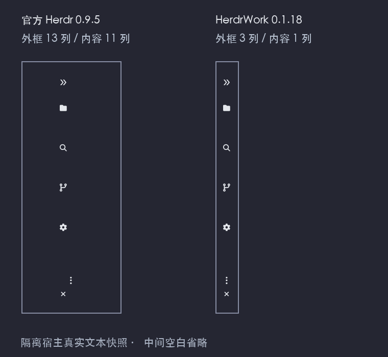

# Herdr 精确列宽补丁

适用来源：Herdr `v0.9.3` 与 `v0.9.5`，私有协议 22。两版官方程序仍将显式分栏比例限制为 10%–90%。

| 宿主版本 | 固定 commit | 对应补丁 |
| --- | --- | --- |
| `v0.9.5` | `2ecf19a92fc3a7fff75b6ce3655ef04f4625ec01` | [0.9.5 补丁](precise-split-ratio-v0.9.5.patch) |
| `v0.9.3` | `7b116c05bfda646af39d2524c54e70c751f57ee8` | [0.9.3 补丁](precise-split-ratio.patch) |

- [上游源码](https://github.com/herdrdev/herdr/tree/7b116c05bfda646af39d2524c54e70c751f57ee8)
- [0.9.3 补丁](precise-split-ratio.patch)
- [原 Apache-2.0 许可证](LICENSE)

官方宿主将 `pane.resize` 和显式比例设置都限制在 10%–90%，因此 HerdrWork 请求 1 列后仍会得到宽图标栏。补丁只让 `layout.set_split_ratio` 使用精确比例，按当前几何保证子窗格至少保留一个单元格；原鼠标拖拽、键盘缩放和普通 `pane.resize` 的限制不变。不修改协议字段或序列化格式。

HerdrWork 使用明确的分隔线路径设置列宽，保留相邻工作区分栏和焦点，窗口改变时重新保持 1 列内容宽度。宿主外框另占最多 2 列。

## 应用与构建

补丁不是 HerdrWork workspace 成员，也不包含在普通发行包的程序中。普通安装不会替换用户的 Herdr 宿主。请在匹配的独立 Herdr 源码副本中应用。以下以 0.9.5 为例：

```sh
git rev-parse HEAD
# 必须为 2ecf19a92fc3a7fff75b6ce3655ef04f4625ec01
git apply --check --unidiff-zero <herdr-work>/docs/patches/herdr/precise-split-ratio-v0.9.5.patch
git apply --unidiff-zero <herdr-work>/docs/patches/herdr/precise-split-ratio-v0.9.5.patch
# 按 Herdr 自身规范准备 Rust、Zig 0.16.0，再构建和验证。
```

补丁保留来源许可证与版权，不代表上游已接受或发布。HerdrWork 未向上游提交 issue、PR 或发布宿主二进制。

## 0.9.5 验证（2026-11-02，四列基线）

- 官方 0.9.5 私有会话复现：可用宽度 130 列时，折叠侧栏外框仍为 13 列。
- 使用 0.9.5 固定源码构建测试版宿主，Rust 1.96.1、Zig 0.16.0；构建成功。未修改版本号、协议或序列化字段，也未发布上游宿主。
- 独立布局测试 29 项通过、1 项既有性能测试忽略，覆盖左右边缘、嵌套分隔线、焦点、无效比例与无客户端几何；普通键鼠缩放继续保留原限制。
- `scripts/docking_smoke.py --host <测试版-herdr> --exact-rail` 的 12 组私有会话通过：自动启动、显式打开、左右停靠、嵌套分栏、复用已有侧栏、关闭恢复及 160/200 列窗口变化。
- 实际外框为 6 列，其中 4 列内容 = 2 列图标槽 + 左右各 1 列边距；四个活动/设置图标均位于可见范围。
- 没有运行 Herdr 全量测试，也没有验证 Linux/Windows 宿主补丁。用户当前会话未被替换。

## 一列侧栏（HerdrWork 0.1.18）

折叠目标改为 1 列内容、无左右边距；双边框模式的外框共 3 列。宿主的 PTY 缓冲区仍最少 4 列，因此绘制和鼠标命中固定在第一列，不在缓冲区居中。Emoji 主题的宽字形改用单列文本符号，展开后仍使用配置的主题。本次沿用同一精确比例补丁，不需要修改宿主的 PTY 最小尺寸。12 组隔离场景全部通过，覆盖左右/嵌套停靠、自动启动、复用、160/200 列窗口变化及展开/关闭恢复。



图使用隔离宿主的真实布局与侧栏文本快照，按等宽字格渲染，中间空白省略；没有账号、用户目录或 Agent 会话。

## 0.9.3 历史验证与启用边界

macOS Apple Silicon 已完成宿主 release 构建；单独编译原 `layout.rs` 的布局测试，26 项通过、1 项按既有配置忽略。未运行 Herdr 全量测试，未验证 Linux/Windows 宿主补丁。

`scripts/docking_smoke.py --host <测试版-herdr> --exact-rail` 的 8 组私有会话通过，覆盖左右停靠、嵌套分栏、已有侧栏、静默 ensure，以及外层终端在 160/200 列之间变化。验证折叠可见内容宽度为 4 列、双边框模式外框为 6 列，并确认五个图标均在可见区域，展开恢复原宽度，工作分栏树与进程保留。

另以原安装版本启动私有会话，在线交接至测试版后重新连接客户端；工作进程组、窗格 ID 和原分栏树保留，重连后精确列宽验证通过。交接会使原客户端断开，不能将其称为客户端无感升级。

需要单独切换宿主并重新连接客户端；重开 HerdrWork 侧栏本身无法解除旧宿主的比例限制。切换前应保留原宿主程序，以便回退。
