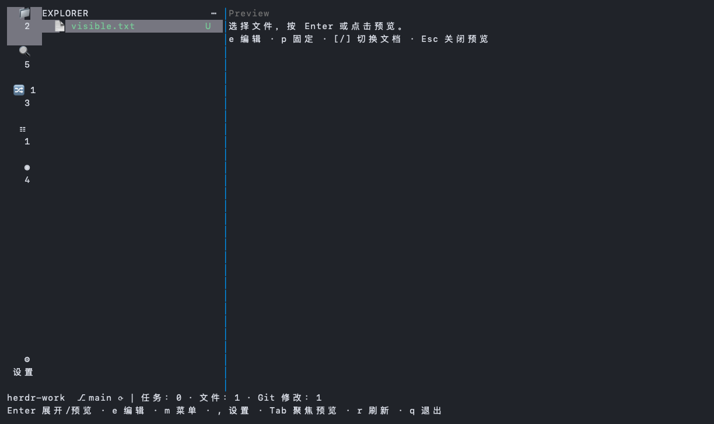
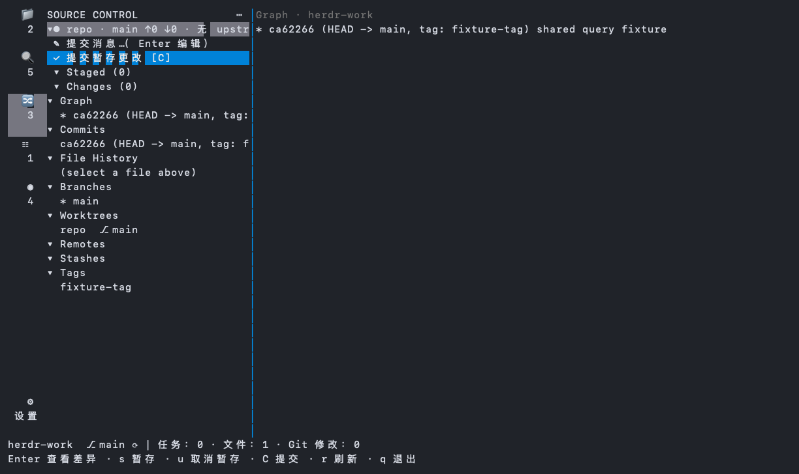
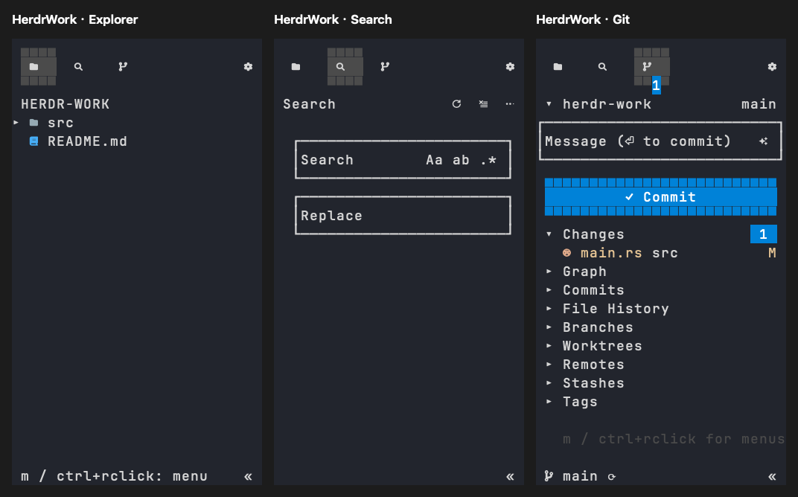

# Sidebar 代码迁移与产品隔离

日期：2026-10-19。导入基线：[Sidebar 081ed133](https://github.com/alexarthurs/herdr-sidebar/tree/081ed133f3faa377438b51ce435fe8a87c439593)，原 package 版本 0.15.1。

## 所有权与来源

原 `upstream/herdr-sidebar/plugins/herdr-sidebar` 已迁入 `crates/herdr-work-code`，包、库和内部命名使用 HerdrWork，自根 workspace、Cargo.lock、target 构建；原独立锁文件退出生产构建。原 MIT 许可证保留于该 crate 的 LICENSE，原说明、维护笔记与插件清单归档在本目录。移除原 fetch-or-build、redeploy 及来源仓库安装/发布脚本，防止手动执行时误下载或关闭独立 Sidebar 窗格；不构成本产品安装入口。

只修改 HerdrWork 仓库内的源码副本。独立安装的 Sidebar、Projects、Reviewr 插件及其注册表、命令、配置、任务、草稿不属于本产品；不得接管、关闭、替换、更新、迁移或卸载它们。共享仓库的文件和 Git 状态仅因用户明确的文件/Git 操作而改变。

默认 Sidebar 直接托管原 `explorer_app::App`、`scm_app::App`；下表中的工作台适配继续用于显式 `ui --standalone`。此前的 [能力盘点](sidebar-capability-audit.md) 记录迁移阶段差异，不能代替当前默认入口的验证。

## 实际代码复用

| 能力 | 原实现与迁移方式 | HerdrWork 接入 |
| --- | --- | --- |
| 文件树与图标 | 原 Tree、图标分类、Git::discover_all/status、调色板 | Explorer、图标活动栏、Git 装饰、焦点与预览 |
| 文件菜单 | 原 actions::menu_entries、名称校验和 create/rename/delete、剪贴板、系统打开/显示 | 工作目录边界、操作前快照及删除确认；后台执行 |
| Quick Open / 内容搜索 | 从原 explorer_app 原位抽出 search 模块，原排序、模糊匹配、ignore walker、正则、全词及 glob 规则 | 缓存索引即时过滤、300 ms 防抖、筛选与命中行定位；请求序号拒绝旧结果 |
| 八类 Git 面板 | 从原 scm_app 原位抽出 scm 模型及查询分派；原 Git graph/commits/history/branches/worktrees/remotes/stashes/tags | 可展开列表与独立内容区，真实对象详情 |
| 对象菜单 | 原菜单、引用解析及 Git 参数构造迁入同一 scm 模块，来源界面也调用该模块 | 查看/复制/显示及 checkout、merge、cherry-pick、revert、reset、stash、fetch、删除等；确认后重新检查身份/HEAD/index/内容/引用，记录未知结果 |
| 暂存、取消暂存和提交 | 原 Git::stage_under/unstage/unstage_under/unstage_all/commit | Explorer 文件/目录、SCM 文件/目录/整仓入口；整仓暂存使用原 stage_under 的嵌套仓库边界；保留目录与仓库实例、HEAD、index、完整相关内容、锁与确认快照检查 |
| SCM 目录树与提交输入 | 原 scm_app 的树构建、字符/光标编辑、仓库标题/提交框/三行按钮及视口原位移至 scm_tree/scm_input/scm_widgets，来源界面调用共享实现 | SCM t 切换树/列表、分仓库分组、带边框常驻提交框及按钮；绘制与命中共享变高行视口；各仓库草稿与字符光标只保存于 HerdrWork git-drafts；后台快照加载、带修订号的合并式保存、退出 FIFO 确认，失败保留输入 |
| 分支、同步、丢弃与 Stash | 原 BranchPicker、Git 分支方法、sync、discard 与 stash push --include-untracked | 活动仓库明确显示 branch/ahead/behind/upstream；未合并删除生成独立第二次 FORCE DELETE 确认；Unknown 通过与 CLI 共用的 reconcile/resolve 接口显式记录证据，不自动重试 |
| 悬浮与快捷动作 | 原 scm_app 的动作枚举、命中区域和文件/目录/分组行绘制原位移至 scm_view；Explorer 直接调用原 file_view 与标题按钮 helper | 标题新建/刷新/折叠、树/列表；文件/目录/分组与仓库快捷动作使用相同可见几何，隐藏按钮不可命中；Git 修改继续走确认快照 |
| 提交消息建议 | 原 suggest::generate 与 diff_for_message | 后台生成；缺少 claude 或失败沿用来源文件名回退；用户已修改的草稿不被异步建议覆盖 |
| 内置文本编辑 | 直接使用原 Editor；原缓冲、Unicode 光标、选择、粘贴、查找、换行/BOM 保存和外部修改检查 | e 编辑、滚轮、Ctrl+S 保存、clean 自动重载及冲突继续/重载/明确覆盖；后台保存保留新输入；二进制、无效 UTF-8、超过 1 MiB/5000 行保持只读 |
| 只读文档 | 原 viewer 的 Doc、加载、布局、选择和复制队列移动至共享 preview，来源 viewer 同用 | 高亮/行号/换行/选择复制、Markdown、图片、可选视频封面、固定文档；无来源窗格生命周期依赖 |
| 撤销/重做 | 在共享 Editor 内补充有界历史；64 步且历史文本最多 16 MiB，键盘及粘贴共同使用 | Ctrl+Z、Ctrl+Y/Ctrl+Shift+Z；保存后撤销仍正确标识 dirty |
| 外观和工作区状态 | 原 appearance、TreeState/ScmState 纯 DTO、FooterZones 和树导航 | 产品 ui.json 字段合并保存；按目录实例恢复树、SCM/抽屉和固定文档；关闭装饰跳过可选扫描；唯一底栏显示活动仓库 |
| 自有宿主活动 | 原活动映射抽至纯 activity，生产复用 launch 运行时与停靠计算，排除 ensure 生命周期 | 自有 activate 在 UI 锁前验证 profile/实例/前台程序；宿主分配 TTY 或聚焦自有窗格，保留编辑和弹窗 |

Git 确认指纹包含相关 tracked/untracked 内容，预算为 256 MiB。超预算或内容无法核对时，Explorer/SCM 仍返回路径和状态，并通过 `write_error` 明确标识只读安全快照；该快照不能授权暂存，修改计划仍必须取得完整指纹。

HerdrWork 保持唯一终端和事件循环。生产 `sidebar-ui` 特性直接编译原文件树、搜索、SCM、viewer、takeover、launch 与恢复逻辑，`sidebar_component` 仅路由原 Exit 转换，`source_sidebar` 承接唯一输入循环和宿主活动。`reference-ui` 仅用于验证保留来源二进制及其安装生命周期；生产不启用该特性，不包含原插件安装、升级和统一卸载入口。

产品配置显式绑定 `<HerdrWork profile>/sidebar`，忽略独立插件资料路径，viewer/editor 子进程调用本产品隐藏入口。viewer 使用产品专属 metadata 与 profile 指纹，恢复记录按自有 socket/session 隔离。原 `LaunchLock` 机械移至 `pane_lock`，原根目录记忆机械移至 `root_memory`；参考入口继续调用同一实现。

默认 viewer 沿用来源 Replace/takeover：原 pane 移入停车标签页，原进程保留；viewer 在 Sidebar 旁占据实际空间，关闭时按原恢复日志恢复 pane 与分栏。后台定期使用来源恢复函数处理退出和中断后的记录。没有以 overlay 替代 takeover。

## 专属任务 worker

`crates/herdr-work-projects` 为独立产品入口，调用已导入的 Projects 库。入口在启动线程前强制设置自己的 home/data/settings/reports，资料由 HERDR_WORK_HOME 或默认 ~/.herdr-work 决定；不以继承的 HERDR_PROJECTS_* 路径决定资料，不依赖调用方正确设置 managed 标记。继承的第三方插件 ID/context 会清除，原 Agent 回调中的空插件身份保留。主程序、hook 和生成 launcher 显式传递 HerdrWork home，防止回到独立插件目录。

两个发布程序均由根 Cargo.lock 和 target 构建。Projects、Reviewr 的其余源码迁移及最终九模块整合仍由 #17 跟踪，本次不把它们标成已完成。

## 验证边界

- 根 workspace 测试包含 Code 原库测试、编辑器/搜索/面板/菜单/设置交互、文件与 Git 状态保护和专属 worker 的两种资料路径隔离；Code 原库中的 3 项测试沿用原有 ignored 标记。
- 保留来源界面通过 `cargo test -p herdr-work-code --features reference-ui --bin herdr-work-code-browser --locked` 单独验证；不能把仅核心库通过等同于原界面测试通过。
- macOS 私有 PTY 实际验证实时搜索第80行、Quick Open、预览自动刷新、菜单/设置、120行编辑滚轮/保存、clean 重载和 dirty 保存冲突、真实 stage/unstage/Diff、创建任务、80列和终端恢复；自有活动另以私有 socket/PTY 验证。Windows 运行 Rust 渲染和业务检查，不声称验证过原生 Unix PTY 或 Unix 任务执行。
- 安装可选 glow/ffmpeg 后，来源 glow 测试和 Engine 的 Markdown/真实临时视频封面 opt-in 测试已实际通过；普通 CI 无需这些可选工具，不把涉及用户实际 Herdr 窗格的 takeover ignored 测试当作已执行。
- 安装生命周期测试在相同 prefix 放置独立 Sidebar/Projects/Reviewr 命令、配置及注册表，验证重装、回滚、卸载后字节不变；worker 实际启动与创建任务时验证第三方资料不变。
- 另外运行过原 Projects 的独立 fixture 基线：828 通过、6 失败。失败涉及两项旧目录迁移时序、旧共享 Cargo 配置链接、原生只读规划沙箱前提、旧插件进程接管和旧 warm-start 构建路径。这不是本次新增生产功能的通过证据，不修改或忽略后冒充通过；保留给 #20 的来源测试迁移分析。原始日志仅存本地，未提交。

界面图为临时 Git 仓库与测试数据渲染的 fixture，不包含用户工作目录或 Agent 会话：

## 搜索控件复用

从固定 Sidebar 源码 `081ed133f3faa377438b51ce435fe8a87c439593` 的 `explorer_app.rs::draw_content_search` 提取布局、`search_input_line`、`search_toolbar_icons` 和边框绘制至 `crates/herdr-work-code/src/search_widgets.rs`。来源界面与工作台均直接调用；空输入隐藏占位文字、输入末尾省略、块状光标及原有来源测试保留。

工作台沿用原标题工具栏、三列选项间距、输入框缩进与过滤条件边框，不再使用另设的灰底输入条。适配点：搜索结果与异步任务继续由工作台单一事件循环处理；工作台新增 VS Code 风格的替换行，通过 `SearchLayout::vscode` 适配同一布局；保留原参考界面的布局入口。窄小区域统一裁剪，空间不足时隐藏工具栏或内嵌选项，键盘入口继续可用。

## VS Code 风格工作台适配

文件行、状态装饰与滚动条继续调用 Sidebar 的 `file_view` / `ui` 实现。原 `draw_header` 的大写标题片段移动到 `file_view::workspace_name_span` 供参考界面调用；工作台使用同模块的根目录标题适配，保留目录名大小写并支持根节点折叠。活动按钮统一固定尺寸和图标占位，数量角标由图标矩形计算，显示与鼠标命中共用几何。

搜索结果的 `highlighted_search_context`、`truncate_path_tail` 从同一固定来源机械提取到 `search_widgets`，原测试与参考调用保留。工作台按文件分组显示，原内容搜索匹配范围贯通 Engine 至 TUI。替换是新增用例，匹配范围复用原搜索算法，捕获组由现有 regex 依赖展开；Engine 生成固定文件快照并预检，执行通过原 EditorSession / Editor 保存，保留 BOM、换行及磁盘变化检查。执行中途失败会报告已保存文件数，不声明跨文件原子回滚。

Sidebar `launch.rs` 的纯布局类型、`open_plan`、`resize_plan`、`preferred_resize_plan`、`layout_width` 与 `repair_step` 机械移动至生产共享模块 `dock.rs`，原入口重导出，来源测试保留。HerdrWork 的活动入口只为当前原终端创建本产品侧栏，沿用 split → swap → resize 的原停靠顺序；不调用独立插件的 ensure、配置、接管或更新。HerdrWork 默认 28 列并优先保持设定列宽，宽屏不再强制至少占 15%；遵守实际宿主 10% 下限及来源半屏上限。参考入口仍使用原 15%–50% 界限。`ui --standalone` 保留完整工作台，宿主内普通 `ui` 在获得数据锁前转交活动入口，避免重复实例报锁错误。

## 默认入口验证

默认 Sidebar 与直接创建原 App 的绘制缓冲在 28×24、32×24、48×32、80×24 下逐格比较，覆盖文件、搜索和 SCM。另以隔离 Herdr session 检查实际宿主创建与 takeover；不会以 fake socket 测试代替真实布局验收。验证只使用临时仓库、专属 profile 和测试 pane，不操作用户已有会话。

本轮在 macOS Apple Silicon 验证通过：根 workspace 测试、保留来源界面测试、默认组件三种尺寸逐格对照、Python 安装测试、原生构建与归档隔离安装 smoke、完整工作台 PTY smoke。独立 Herdr session 的三块工作 pane 测试实际验证停车期间进程身份不变、第二个文件复用 viewer、关闭后 pane ID/方向/比例/矩形精确恢复，宿主直接关闭 viewer 后后台恢复同样通过；另从第二个安装前缀调用活动入口验证聚焦同一实例。Linux/Windows 本轮原生交互未执行。

可复现的宿主验收入口为 `scripts/sidebar_smoke.py --socket <isolated-session-socket> --binary bin/herdr-work --output <new-fixture-directory>`；先在隔离 session 链接本仓库插件，入口拒绝继承的用户 socket，创建并最终关闭自己的测试 workspace。可选 `--activation-binary <second-installation>` 验证跨安装前缀聚焦。不得传入用户会话。

产品宿主标题分别为 `HerdrWork · Explorer`、`HerdrWork · Search`、`HerdrWork · Git`；设置窗口使用 `HerdrWork Settings`，与独立 Sidebar 区分。
