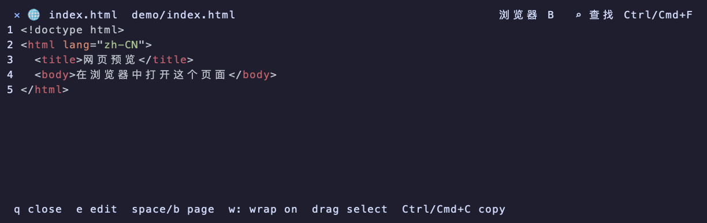

# 网页通过浏览器打开

日期：2026-10-31。执行平台：macOS Apple Silicon。

## 行为

文件打开方式新增持久化值 `browser`，展示为“浏览器（网页）”。该模式只将 `.html`、`.htm`、`.xhtml` 文件交给外部浏览器；普通文件保持原有打开规则，Git Diff 和历史继续使用内置查看器。原有打开模式和资料隔离规则保留。

网页文件的菜单增加“通过浏览器打开”，不必修改默认方式。HTML 源码预览标题栏提供“浏览器 B”，也可按大写 `B`；窗口较窄时保留快捷键。菜单、设置和快捷打开 / 搜索结果复用同一个浏览器启动入口。Standalone 工作台也提供网页菜单与预览按钮。

macOS 通过 AppKit 查询默认 HTTP 浏览器，再明确指定该浏览器打开本地文件 URL，避免 `.html` 被关联到文本编辑器时打开错误应用。Linux 使用桌面默认浏览器入口；Windows 查询 HTTPS 处理程序。文件名按 URL 编码作为独立参数传入，不拼接 shell 命令。启动器在后台执行，并清除宿主身份环境；启动失败提供提示，不覆盖页面或改写设置。

## 验证

```sh
cargo fmt --check
cargo test -p herdr-work-code -p herdr-work-tui --locked
cargo clippy -p herdr-work-code -p herdr-work-tui --all-targets --no-deps --locked -- -D warnings
python3 -m unittest discover -s scripts/tests -v
cargo build -p herdr-work --locked
python3 scripts/tests/browser_preview_fixture.py target/debug/herdr-work
git diff --check
```

单元测试覆盖网页类型、特殊路径编码、非网页与目录边界、菜单筛选、设置循环和持久化，以及标题栏浏览器 / 查找 / 关闭按钮的几何隔离。组件截图使用合成页面和 TestBackend 实际帧。

真实程序 PTY fixture 使用模拟浏览器启动器，验证设置切换、选中文件、一次性菜单、预览按钮与 `B`、中文 / 空格 / shell 特殊字符路径、宿主环境隔离、普通文件回退及启动失败提示。测试不会打开用户的实际浏览器。另在本机核对默认 HTTP 浏览器的 AppKit 查询结果；未进行真实浏览器页面渲染验收或 Linux / Windows 原生交互验收。

已执行 `sh herdr-work-plugins.sh install`，并针对安装后的 `bin/herdr-work` 重跑网页 PTY fixture；`python3 scripts/smoke.py --archives dist` 隔离归档安装与交互检查通过。当前插件 Sidebar 已重启并确认就绪。


