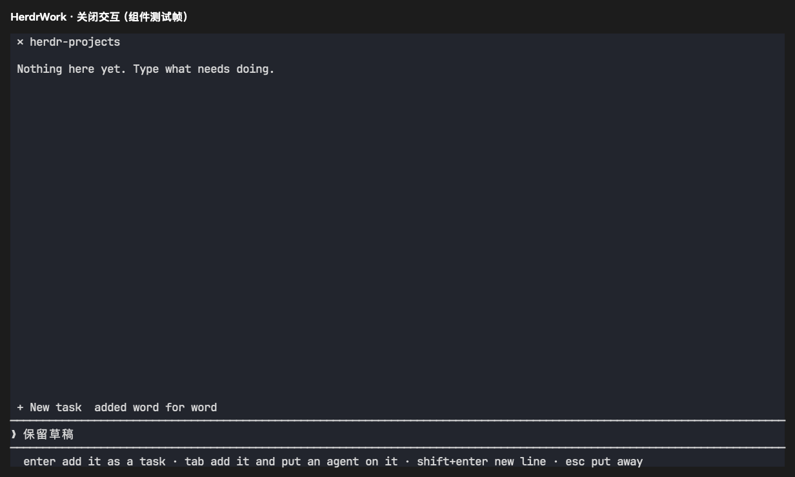
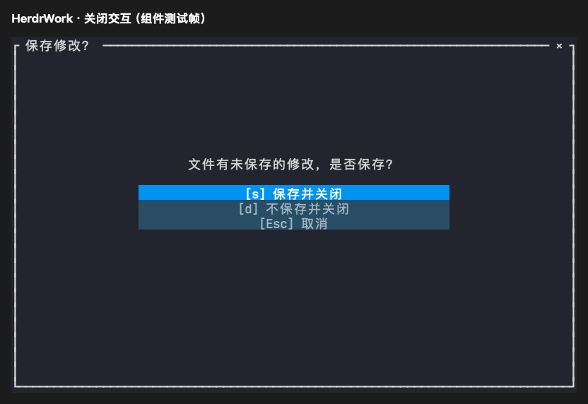

# Projects 与编辑器关闭交互验证

日期：2026-10-23。平台：macOS Apple Silicon。

Projects 看板的标题左侧加入与 Preview 一致的三列 `✕` 按钮。入口明确传递调用方的 workspace，并按 workspace 记录已打开的看板；重复打开只聚焦当前 workspace 的看板，不跳转到其他 workspace。每次打开记录返回页面，关闭时先保存草稿、回到最近的来源页面，再关闭自有看板 tab。关闭请求在后台执行；宿主拒绝时保留看板并允许重试。直接在普通终端启动的看板不会关闭所在宿主 tab。



编辑器有未保存内容时，点击标题的 `✕` 显示与编辑面板同尺寸的确认菜单，可选择保存并关闭、不保存并关闭或取消。菜单右上角的 `×` 等同取消；支持鼠标、Tab/方向键、Enter 和原有字母快捷键。菜单拦截编辑输入和鼠标，保存失败保留菜单并显示错误，磁盘外部修改继续走覆盖或重新加载确认。



两张图均从 Ratatui TestBackend 的实际绘制缓冲区导出，是组件测试帧，不是宿主窗口截图。

## 可复现检查

```sh
cargo fmt --check
cargo test --workspace --locked -- --test-threads=1
cargo clippy -p herdr-work-code -p herdr-work-engine --all-targets --locked -- -D warnings
python3 -m unittest discover -s scripts/tests -v
cargo build -p herdr-work -p herdr-work-projects --locked
python3 scripts/tests/projects_entry_fixture.py target/debug/herdr-work
python3 scripts/tests/viewer_close_fixture.py target/debug/herdr-work
git diff --check
```

新增看板集成测试覆盖两种 workspace 的创建和复用、最近来源页面、关闭失败重试、只关闭自身 tab、独立插件身份保护，以及宽窄窗口绘制和草稿保留。真实私有 PTY 验证产品入口的 workspace 参数、防重复和失败重试；编辑器验证保存、放弃、右上角取消、磁盘冲突及原有关闭返回和邻接窗格保护。

最终串行 workspace 测试 543 项通过、4 项按既有配置忽略，Python 41 项通过；格式、debug 构建、两个真实 PTY 脚本及 `git diff --check` 通过。

Code/Engine 严格 Clippy 通过。Board 的 Clippy 被未修改的 `src/board/textbox/mod.rs:298` 既有 `almost_swapped` 错误阻断，另有来源代码警告，未记为通过。默认并发全量测试曾在既有布局锁测试中出现一次失败，单独重跑通过，串行复核用于规避该并发干扰。

本次未执行 Linux/Windows 原生交互、发布归档安装或真实宿主窗口手工验收。
