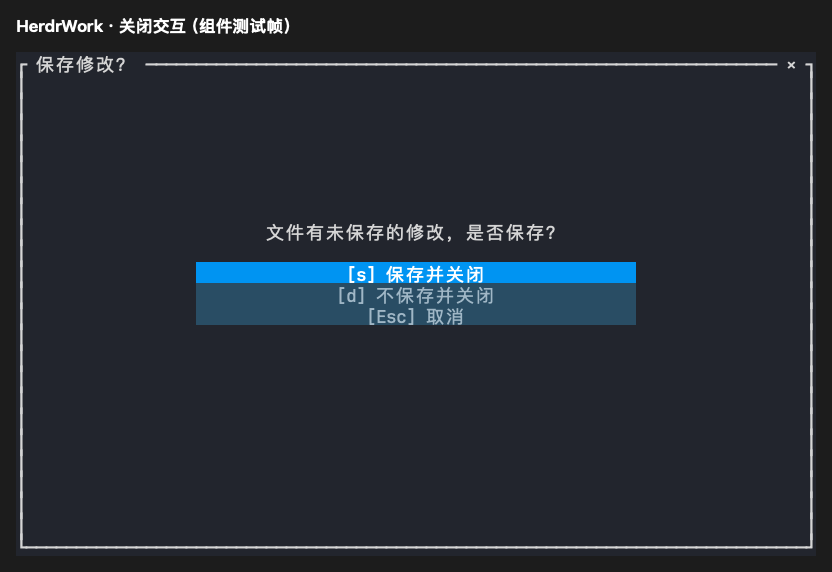

# 编辑器关闭交互验证

日期：2026-10-23。平台：macOS Apple Silicon。2026-11-01 清理：原任务看板已退出产品，本文只保留编辑器范围。

编辑器有未保存内容时，点击标题的 `✕` 显示与编辑面板同尺寸的确认菜单，可选择保存并关闭、不保存并关闭或取消。菜单右上角的 `×` 等同取消；支持鼠标、Tab/方向键、Enter 和原有字母快捷键。菜单拦截编辑输入和鼠标，保存失败保留菜单并显示错误，磁盘外部修改继续走覆盖或重新加载确认。



图从 Ratatui TestBackend 的实际绘制缓冲区导出，是组件测试帧，不是宿主窗口截图。

## 可复现检查

```sh
cargo fmt --check
cargo test --workspace --locked
cargo clippy --workspace --all-targets --locked -- -D warnings
python3 -m unittest discover -s scripts/tests -v
cargo build -p herdr-work --locked
python3 scripts/tests/viewer_close_fixture.py target/debug/herdr-work
git diff --check
```

编辑器 fixture 检查保存、放弃、右上角取消、磁盘冲突，以及关闭返回和邻接窗格保护。跨平台构建与归档安装以同一源码 SHA 的 CI 为准，真实宿主窗口手工验收不计为已执行。
