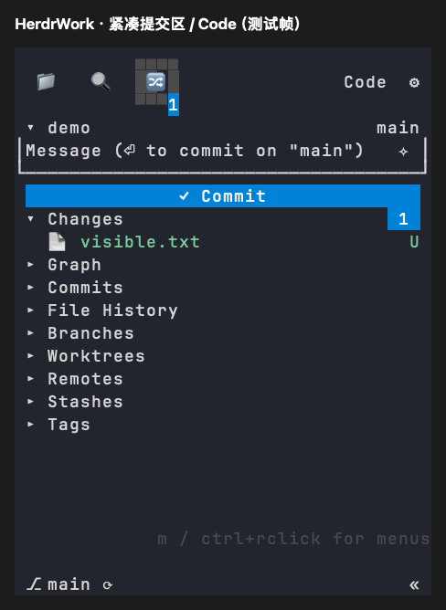

# Git 提交区与顶部编辑器入口

日期：2026-10-21。平台：macOS Apple Silicon。

2026-10-22 补充：输入框的后续修正见[提交输入框布局](scm-input-layout.md)，顶部按钮已改为 [Projects 入口](projects-entry.md)。以下保留 2026-10-21 的实现与验证记录。

## 可见变化

- 单仓库提交框保留侧边和底边，空草稿占两行；提交按钮从三行压缩为一行。输入框与按钮合计从六行降至三行，长消息仍自动换行并限制可见内容高度。
- 多仓库和独立工作台复用的提交按钮同步改为一行，行高、滚动和鼠标命中共用对应几何。
- Explorer、搜索、Git 顶部设置按钮前增加 `Code`，点击通过 VS Code 打开当前项目目录，不改变文件默认打开方式。空间不足时显示 `<>`，不足两列则隐藏，避免覆盖活动图标与设置按钮。
- 角标沿用数量为零时不绘制的规则，增加 `12 → 1 → 0` 连续帧检查，验证数字及蓝色背景均被清除。截图中的单条蓝色块尚未在当前组件中复现，不将其原因归结为零计数逻辑。



上图由真实 Sidebar 组件和 Ratatui TestBackend 导出，是组件测试帧。使用临时仓库与产品资料，不包含用户目录或资料。

## 验证方式

```sh
HERDR_WORK_TEST_FRAMES=<绝对输出目录> cargo test -p herdr-work-code --features sidebar-ui --test compact_scm --locked
cargo test --workspace --locked
cargo clippy --workspace --all-targets --locked -- -D warnings
cargo fmt --check
python3 -m unittest discover -s scripts/tests -v
python3 scripts/tests/vscode_settings_fixture.py target/aarch64-apple-darwin/release/herdr-work
```

组件检查覆盖 28 列短侧栏与 38 列视图、提交输入点击和文件列表空间；工作台既有检查覆盖多仓库提交确认与鼠标目标。私有 PTY 使用真实产品二进制和临时 `code` 启动器，检查 Explorer、Git 的工具栏点击及设置入口，验证项目路径与失败提示。未手动验收外部 VS Code 窗口，也未执行 Linux/Windows 原生验证。

本次结果：workspace 505 项通过、4 项忽略；Python 26 项通过；Clippy、格式检查和私有 PTY 检查通过。macOS release 构建完成。
