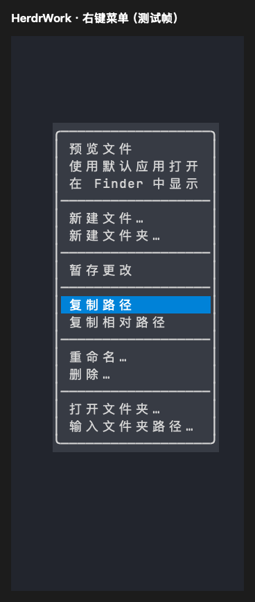

# 文件右键菜单与预览关闭验证

日期：2026-10-21。平台：macOS Apple Silicon。

## 用户可见变化

文件菜单使用中文，按打开与定位、新建、Git、路径复制、重命名与删除分组。保留原文件、Git 和剪贴板实现，增加现有文件预览的菜单入口。`Ctrl+右键` 或 `m` 打开菜单，方向键和滚轮选择，Enter 或单击执行；分隔线不可选，点击菜单外关闭。中文按终端显示列宽计算，短窗格滚动后鼠标仍指向实际显示的选项，悬停不移动已经可见的行。

下图由实际 `context_menu` 组件的 Ratatui TestBackend 帧导出，选中“复制路径”；属于组件渲染证据，不是宿主窗口截图。



## 关闭问题与回归

独立 Sidebar 出现在文档预览标签页内时，viewer 为保护该插件仅关闭自有窗格，却遗漏返回来源标签页；宿主拒绝 `pane.close` 或 `tab.close` 时，旧逻辑仍删除控制文件并退出。隔离 PTY 中运行真实 `sidebar-viewer`，点击文档左上角关闭按钮，旧程序分别出现 `Close did not return to the original page` 和 `Rejected close exited viewer or discarded its control`。

修复在关闭文档前返回来源页面；有其他插件时保留其窗格。关闭失败会重新聚焦文档，保留内容及控制文件，显示失败提示并允许重试。未保存编辑确认和 Replace 的来源 takeover 恢复继续复用。

## 可复现检查

```sh
cargo fmt --check
cargo test --workspace --locked
cargo clippy --workspace --all-targets --locked -- -D warnings
cargo test -p herdr-work-code --bin herdr-work-code-browser --features reference-ui --locked
python3 -m unittest discover -s scripts/tests -v
python3 scripts/tests/viewer_close_fixture.py target/debug/herdr-work
python3 scripts/build.py --target aarch64-apple-darwin
python3 scripts/package.py create --target aarch64-apple-darwin --output .scratch/menu-close-package
python3 scripts/smoke.py --archives .scratch/menu-close-package
```

本次 workspace 502 项通过、4 项按既有配置忽略；来源界面 54 项、Python 26 项通过。真实 viewer 覆盖有无邻接插件，以及首次成功或宿主拒绝后重试四种组合；该检查已接入 Unix 归档 smoke。菜单测试覆盖中文完整显示、28/22 列与极小区域、滚动后的真实鼠标重命名目标，以及悬停位置稳定性。

另按 [Sidebar 共存验证](sidebar-coexistence.md) 在私有真实 Herdr 会话运行双侧检查：鼠标关闭预览后，三工作进程、原 pane ID、分栏方向、比例与侧栏焦点恢复；独立 Sidebar 自己打开/关闭文档也通过，源程序哈希不变。仅操作测试创建的会话、配置和窗格。

Linux/Windows 原生交互本次未执行；不以 macOS 结果替代跨平台验收。
