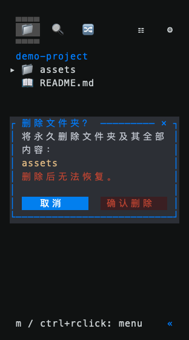

# Explorer 删除确认弹窗

日期：2026-10-31。平台：macOS Apple Silicon。

## 可见变化

- Explorer 的“删除…”使用居中中文弹窗，显示捕获的文件 / 文件夹路径、永久删除提示、“取消”“确认删除”和关闭按钮。目录提示包含全部内容。
- 默认选择取消。鼠标可直接点击按钮；Tab / 方向键切换，Enter / Space 执行当前选项，Esc / N 取消，Y 确认。
- 弹窗独占键鼠：点击背景、滚轮、视图切换和 Quick Open 快捷键不穿透；当前目录跟随与宿主激活仍遵循原来的忙碌状态。
- 长中文名称按显示列宽换行，窄窗格将按钮改为上下排列。窗口过小、无法完整展示目标和提示时，确认不可用，仍可取消。
- 删除复用原 `actions::delete` 及菜单捕获的目标。失败时保留目标和错误，将焦点恢复为取消；用户可显式重试。



上图由真实 Explorer 和 Ratatui TestBackend 导出，使用临时脱敏项目及 Emoji 图标。图片用于组件布局验收，不代表宿主窗口的手动截图。

## 验证

```sh
HERDR_WORK_TEST_FRAMES=/tmp/herdr-work-delete-frames cargo test -p herdr-work-code --features sidebar-ui --lib --locked explorer_app::delete_tests
cargo test --workspace --locked
cargo clippy -p herdr-work-code --features sidebar-ui --all-targets --locked -- -D warnings
cargo fmt --check
python3 -m unittest discover -s scripts/tests -v
python3 scripts/build.py --target aarch64-apple-darwin
python3 scripts/tests/delete_confirmation_fixture.py target/aarch64-apple-darwin/release/herdr-work
```

- 7 个直接回归用例覆盖取消 / 关闭 / 默认 Enter、非空目录、固定目标及相邻文件保护、失败与重试、快捷键和背景点击隔离、长中文名称及窄窗格。
- 私有 PTY 使用实际产品程序，以深色、浅色和终端配色验证点击取消 / 关闭 / 确认、默认 Enter 与 Ctrl+P 隔离；点击位置取自屏幕上实际绘制的菜单和按钮。所有删除均限于夹具临时目录。
- 最终全仓测试、Code 严格 Clippy、格式及差异空白检查通过；Python 41 项通过。macOS release 构建完成。
- 开发阶段曾出现既有 `pane_lock` 释放后立即重取的用例失败；独立重跑与最终全仓均通过，未修改该锁实现。

本次变更随 0.1.13 发布，最终三平台候选、正式构建及附件验收见 [发布任务 #41](https://github.com/JTBlink/herdr-work/issues/41)。本机验证不替代 Linux / Windows 原生 Runner 结果，未进行三平台 GUI 人工验收。
