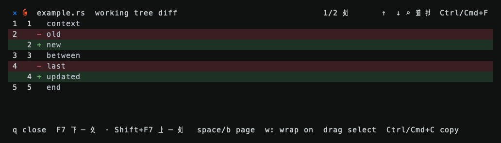

# Diff 差异导航

日期：2026-10-30。平台：macOS Apple Silicon。

## 可见变化

- 文件工作区、暂存区和未跟踪文件的 Diff 预览，在标题右侧显示差异计数与 `↑` / `↓` 按钮；`F7` / `Shift+F7` 跳到下一处 / 上一处，首尾循环。
- 连续的删除和新增行合为一处差异，沿用原 Diff 解析及词级高亮。导航依据源行，窗口缩放和长行换行不会增加虚假差异。
- 末尾多个差异共用一个滚动视口时，差异计数仍逐项切换；手动滚动后从当前位置导航。相同内容的后台刷新保留当前差异，内容更新后重建导航。
- 窄窗格优先保留箭头，查找入口缩为图标；关闭、导航和查找使用互不重叠的点击区域。无文本差异时显示 `0/0` 并将箭头置灰。



上图来自实际 `draw_doc` 与 Ratatui TestBackend 的 100 × 12 组件帧；使用脱敏夹具，不代表宿主窗口的手动截图。

## 验证

已执行：

```sh
cargo fmt --check
cargo test --workspace --locked
HERDR_WORK_DIFF_CAPTURE=/tmp/herdr-work-diff-capture.json cargo test -p herdr-work-code --lib --features sidebar-ui --locked viewer::changes
cargo clippy -p herdr-work-code --features sidebar-ui --all-targets --locked -- -D warnings
python3 -m unittest discover -s scripts/tests -v
python3 scripts/build.py --target aarch64-apple-darwin
python3 scripts/package.py create --target aarch64-apple-darwin --output /tmp/herdr-work-diff-package
python3 scripts/smoke.py --archives /tmp/herdr-work-diff-package
```

- Workspace：576 项通过、4 项忽略；后续补充的真实 Git 用例与其余导航专项共 6 项通过。另有 Diff 解析用例覆盖连续替换、同 hunk 的多块修改、跨 hunk、二进制及空 Diff。
- Python：41 项通过；Code 严格 Clippy、格式与差异空白检查通过。
- macOS release 构建、归档 SHA256 / MANIFEST 校验、隔离安装与卸载、既有 UI smoke 通过。
- 额外使用构建后的实际程序和临时 Git 仓库，在私有 PTY 中发送 F7、Shift+F7 与鼠标序列，验证差异计数和首尾循环；环境清除宿主连接变量，使用临时产品资料，不影响用户窗格。

以上为版本号 0.1.11 下的开发阶段验证记录；此阶段未执行 Linux / Windows 原生验证及宿主窗口手动验收。本次变更计划随 0.1.12 发布，最终源码的三平台候选、正式构建与附件验收结果见 [发布任务 #40](https://github.com/JTBlink/herdr-work/issues/40)。
