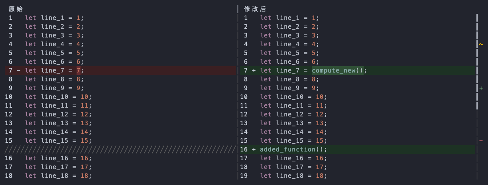
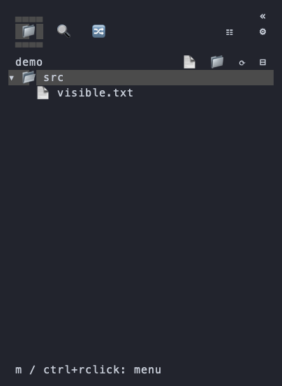

# 全文 Diff 与顶部折叠

日期：2026-10-31。平台：macOS Apple Silicon。交付任务：[GitHub #44](https://github.com/JTBlink/herdr-work/issues/44)。

## 可见行为

- 工作区、暂存区和未跟踪文件的 Diff 保留完整上下文，相同行不再省略。无文本差异时仍显示文件内容；暂存区始终使用索引内容，不混入后续未暂存修改。
- 宽窗口左右对照原始 / 修改后内容，各自显示行号、语法颜色、行与词级差异；新增或删除在另一侧补空白，两侧同步滚动和换行。窄窗口自动显示完整单列。
- 右侧 `+` / `−` / `~` 标出全文的新增、删除和修改位置，旁边的滚动条显示当前可见范围。点击差异标记跳转，点击或拖动轨道滚动；F7 / Shift+F7 和顶部箭头继续可用。
- 两侧分别查找、选择和复制；搜索和复制不包含另一侧内容、行号或对齐占位。长行换行、窗口缩放及刷新后仍可定位。
- Explorer / Search / Git 顶部关闭按钮替换为折叠，底部折叠入口移除；收起后的展开按钮也在顶部，保留原视图和输入草稿。
- 完整 Diff 沿用有界进程捕获；超出预览大小或行数范围明确提示无法完整显示，不静默省略成局部上下文。





图片由真实 Git fixture、现有高亮器与 Ratatui TestBackend 帧生成，使用脱敏示例。它是组件绘制结果，不冒充 Herdr 宿主的手动截图。

## 验证

```sh
cargo fmt --check
cargo test --workspace --locked
cargo test -p herdr-work --test full_diff --locked
cargo test -p herdr-work-code --features reference-ui --bin herdr-work-code-browser --locked
cargo clippy -p herdr-work-code --features sidebar-ui --all-targets --locked -- -D warnings
python3 -m unittest discover -s scripts/tests -v
python3 scripts/build.py --target aarch64-apple-darwin
python3 scripts/tests/full_diff_fixture.py target/aarch64-apple-darwin/release/herdr-work
```

全仓测试 601 项通过、4 项既有忽略；新增实际程序 PTY 集成单独通过。Python 42 项通过，Code 严格 Clippy 和来源界面 56 项回归通过。Code 真实 Git 回归覆盖完整首尾、隔开的差异、暂存区 / 工作区、带方括号文件名、删除、未跟踪、二进制、空文件与预览上限。组件回归覆盖左右行号、空白对齐、中文长行、缩放、概览点击、独立查找与复制。

私有 PTY 在 vscode / light / terminal 三种配色验证真实 viewer 的文件首尾、左右内容、F7、概览点击与窄屏；另验证顶部折叠 / 展开及侧栏进程保留。所有文件与 Git 修改均限于夹具临时目录，不操作用户窗格或剪贴板。

本任务按用户要求提交后从源码本地安装，保留 0.1.15 版本号并用安装收据记录实际源码 commit；不移动已有标签，不创建正式 Release。安装、签名和最终执行结果回写任务记录。macOS 使用安装时 ad hoc 签名，未执行 Apple 公证；不声明 Linux / Windows 原生人工验收。
