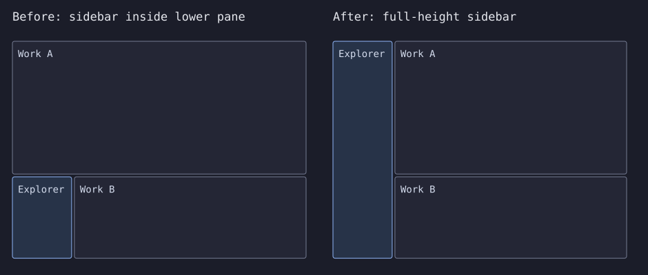
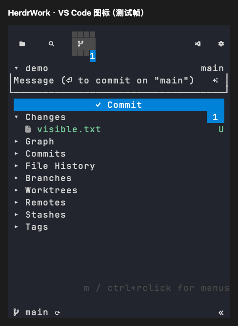
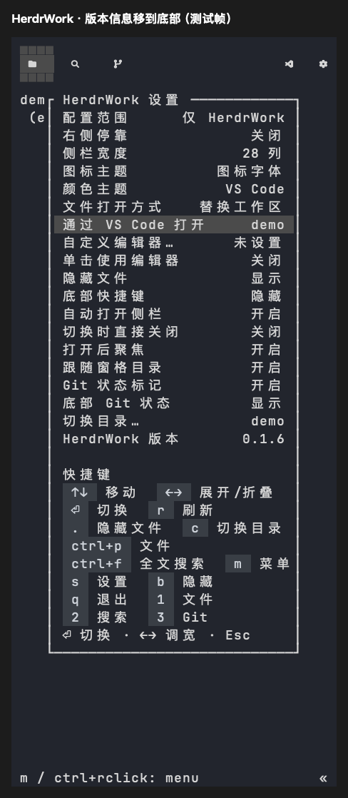

# 侧栏整列停靠与设置顺序

日期：2026-10-22。平台：macOS Apple Silicon。

## 原因和改动

产品活动入口在当前工作 pane 内创建侧栏分栏，没有接入来源 ensure 的整列修复阶段。从下方 pane 打开时，侧栏因此只占下半屏。隔离宿主复现中，标签页高 47 行，侧栏从第 29 行开始、只有 18 行高。

本次复用迁入的 takeover 布局树、持久化 journal、临时停车和 replay，把自有侧栏提升为安全工作子树的整列边栏。原工作区的上下、左右、嵌套分栏与比例保留；终端和 Agent 进程不重新启动。已有半高侧栏在显式打开或自动 ensure 时也可修复，自动 ensure 结束后恢复原焦点。

独立插件及其他产品资料的窗格被排除，不跨越其所在的树边界进行重排。失败继续使用既有恢复规则保留工作窗格，并在活动结果返回 `layout_warning`；临时恢复标签与未恢复内容不被静默删除。预览持有 journal 时让出布局控制。



该图根据真实隔离宿主的 `pane.layout` 矩形生成，属于布局数据可视化，不是窗口截图。

顶部 VS Code 入口改为图标：图标字体使用 VS Code 字形，文本主题使用代码符号。设置中的版本行移到常用配置之后，Explorer 与 Git 一致。





两张 PNG 为真实 Sidebar 组件经 Ratatui TestBackend 导出的测试帧，不含用户资料或目录。

## 复现与验证

```sh
python3 scripts/docking_smoke.py --binary target/debug/herdr-work --output .scratch/docking
cargo test --workspace --locked
cargo clippy --workspace --all-targets --locked -- -D warnings
cargo fmt --check
python3 -m unittest discover -s scripts/tests -v
HERDR_WORK_CODE_ICONS=material HERDR_WORK_TEST_FRAMES=<绝对目录> cargo test -p herdr-work-code --features sidebar-ui --test settings_ui --test compact_scm --locked
python3 scripts/tests/vscode_settings_fixture.py target/aarch64-apple-darwin/release/herdr-work
```

真实 Herdr 检查使用独立配置、会话和 socket。八个场景覆盖新开/已有侧栏、左右停靠、上下/嵌套工作区，以及已有侧栏的自动 ensure；断言整列高度、边缘和宽度、原工作树及比例、前台进程身份、最终焦点、关闭后的原工作树。来源 Fake 宿主检查另覆盖重复调用无重排、独立插件边界及搬移失败保留终端。

结果：workspace 507 项通过、4 项忽略，Python 26 项通过；格式、Clippy、Material 图标与设置组件、VS Code 私有 PTY 和 macOS release 构建通过。

本次未执行 Linux/Windows 原生验收，也未操作用户的工作窗格来模拟故障。
