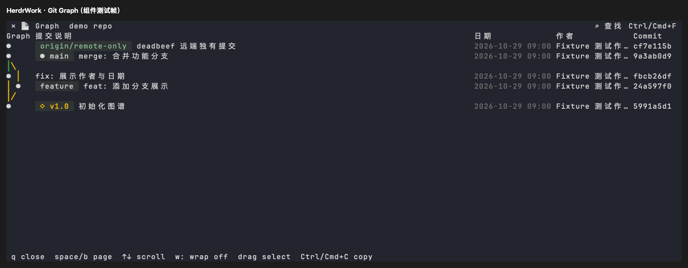

# Git Graph 信息展示

日期：2026-10-29。平台：macOS Apple Silicon。

## 行为与复用

继续使用来源 Git CLI 的 `git --graph` 生成拓扑，查询扩展为全部引用，包含未合并本地分支、远端引用和标签。提交字段用 NUL 分隔读取，保存完整 OID、短 SHA、引用、提交说明、作者日期和作者；不从展示文本反推提交目标。

默认侧栏打开的 Graph 预览显示彩色连线、分支/标签和固定列标题：Graph、提交说明、日期、作者、Commit。100 列以上显示日期与时分，76–99 列显示日期，32–75 列保留提交说明和短 SHA，更窄窗口优先保留图谱与说明。中文按终端列宽截断，长引用不能挤掉整个说明区。空仓库显示“暂无提交”。

复用原 viewer 文档、滚动、查找、复制与关闭流程。Enter 查看顶部提交，双击提交行查看详情，Backspace 返回历史，`r` 刷新。表头不参与正文命中，合并连线空行不能打开提交。原 drawer 字符串接口继续提供短 SHA 在前的行数据，并附加作者与日期。



上图由实际 viewer 的 Ratatui TestBackend 帧导出，使用临时仓库、合成分支、标签、日期和作者，不是用户仓库截图。

## 验证

```sh
HERDR_WORK_TEST_FRAMES=<绝对输出目录> cargo test -p herdr-work-code --features sidebar-ui --lib graph_shows --locked
cargo test --workspace --locked
python3 -m unittest discover -s scripts/tests -v
cargo build -p herdr-work --locked
python3 scripts/tests/git_history_viewer_fixture.py target/debug/herdr-work
cargo fmt --check
git diff --check
```

组件回归通过真实临时 Git 仓库覆盖分叉与非快进合并、远端独有提交、HEAD 与标签、140/80/38/12 列布局、中文列宽，以及说明包含 `deadbeef` 时仍按完整 OID 导航。查询前后比较仓库状态和 HEAD，保证只读。

未执行 Linux/Windows 原生交互或人工宿主窗口验收。折叠栏实际宽度限制单独记录在 [侧栏折叠与关闭](sidebar-collapse.md)。

本次 `0.1.10` 根 workspace 回归：568 项通过、4 项按既有配置忽略；Python unittest 41 项通过。
