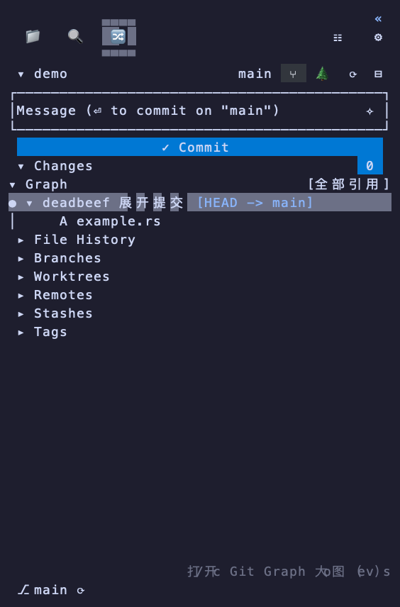
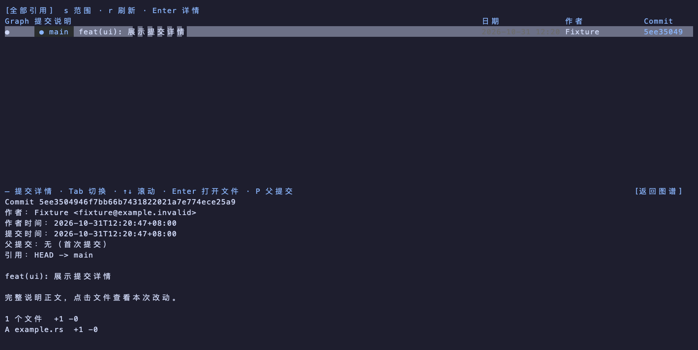

# Git 历史交互验证

日期：2026-10-31。执行平台：macOS Apple Silicon。

## 已实现行为

- 移除独立 Commits 区块及菜单入口。侧栏 Graph 展示紧凑拓扑，单击提交展开文件并预览完整说明；文件行显示状态、文件名及目录，点击查看固定提交的 Diff。
- 工具栏图谱按钮或侧栏列表的 `v` 打开独立 Git Graph 标签；该操作不覆盖临时文件预览，也不修改用户的预览位置设置。重复打开聚焦同一 worktree 的大图。
- 大图单击提交显示下方详情，包括完整说明、作者与提交者、带时区的时间、完整 SHA、父提交、引用及文件统计。窄矮窗口提供“返回图谱”。
- 大图点击文件临时查看该提交的 Diff，Backspace 返回后恢复图谱选择和滚动位置；浏览文件期间仍保留 Git Graph 标签身份。
- 全部引用与当前分支分别查询；空仓库、空提交、读取失败、加载和分页有独立反馈。快速切换提交时，旧接收通道被替换，不会覆盖新目标。
- 合并提交默认比较第一父提交，按 `P` 选择其他父提交；文件列表、统计与 Diff 使用同一比较基准。首次提交与空树比较，重命名保留两条路径，二进制和删除文件保持 Git 的实际语义。

## 自动化验证

本轮 workspace 测试 610 项通过、4 项按既有配置跳过；Python unittest 60 项通过。Code / TUI 严格 Clippy、格式、源码构建及下面两组真实程序 PTY fixture 通过。后续收尾修改另执行 Code / TUI 包回归，结果通过。

```sh
cargo fmt --check
cargo test --workspace --locked
cargo clippy -p herdr-work-code -p herdr-work-tui --all-targets --no-deps --locked -- -D warnings
python3 -m unittest discover -s scripts/tests -v
cargo build -p herdr-work --locked
python3 scripts/tests/git_history_preview_fixture.py target/debug/herdr-work
python3 scripts/tests/git_history_viewer_fixture.py target/debug/herdr-work
git diff --check
```

Rust 临时仓库测试覆盖全部引用 / 当前分支、完整多行说明、完整 OID 导航、首次提交、重命名、特殊路径、二进制、合并父提交、快速切换与工作区修改隔离。Ratatui TestBackend 验证大图单击、详情文件命中、返回以及 140/80/38/12 列布局；侧栏测试验证折叠、文件返回父行及移除 Commits。

真实程序的隔离 PTY 与私有宿主协议 fixture 覆盖 Replace / Tab / Pane 三种文件预览位置，以及没有安全工作区域的回退。验证侧栏单击提交和文件复用预览、打开大图创建独立固定标签、重复大图操作不重复建标签、关闭与返回导航，以及独立插件的布局和身份不受影响。这是私有协议 fixture 验证，不等同于实际 Herdr 窗口人工验收。

全 workspace 严格 Clippy 另外发现来源 `herdr-work-task-data` 的既有告警；本次改动涉及的 Code 和 TUI 已使用上述限定包检查。未为本需求修改来源任务模块的 lint。

## 组件帧截图

截图由实际组件的 TestBackend 单元格导出，经本机字体栅格化；使用临时仓库与合成身份，不是用户项目截图。





生成原始帧：

```sh
HERDR_WORK_TEST_FRAMES=<输出目录> cargo test -p herdr-work-code --features sidebar-ui --lib history --locked
```

未执行 Linux/Windows 原生交互、实际宿主窗口人工验收或发行归档安装验证。本轮只验证本机源码构建，不据此声明新的平台支持。
