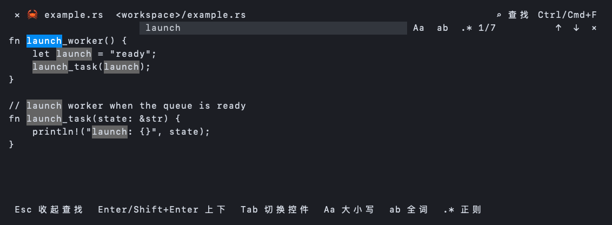

# 文件预览内查找

日期：2026-10-24。平台：macOS Apple Silicon。

根据文件预览区的快速搜索需求，在文件标题栏右侧加入查找入口。查找栏参考 VS Code：右对齐输入框、大小写/全词/正则开关、当前项/总数、上一个/下一个及关闭按钮。宽窗口使用一行，窄窗口分为输入与操作两行。当前匹配使用主操作色，其他匹配使用选择底色和下划线；无结果和无效正则分别显示提示。图片与视频不显示查找入口。



图片来自 Ratatui TestBackend 的实际绘制缓冲区，由系统字体绘制为 PNG；不是宿主窗口截图。

## 按键范围

- Ctrl/Cmd+F：打开或重新聚焦当前预览的查找输入，选中已有关键词，方便替换。
- Enter / Shift+Enter：输入框聚焦时跳到下一个 / 上一个匹配，首尾循环；F3 / Shift+F3 在查找栏打开期间提供相同导航。
- Tab / Shift+Tab：在输入、选项、导航和关闭控件间移动；Enter 或空格操作选中的按钮。
- Esc：查找栏打开时先收起，之后沿用原预览关闭行为。
- Ctrl/Cmd+Q：保留原关闭行为。查找输入中的普通 q/e/w、空格、方向键、Home/End、Backspace/Delete 仅操作查询，不调用预览命令；点击正文后恢复预览按键。
- Ctrl/Cmd+A、Ctrl/Cmd+V 和终端括号粘贴仅在查找输入中作用于关键词；括号粘贴只在查找输入聚焦期间启用，退出查找时关闭。编辑器继续使用原有按键和保存保护。

搜索复用现有 SearchOptions 与文字匹配规则，支持中文及跨自动换行的匹配。窗口大小、Markdown 宽度重载或文件刷新后重新计算位置，并保留仍有效的当前匹配序号；切换文件清除查找状态。查找不会替换正文选择或修改文件。范围是已加载的预览文本，沿用预览的大小和行数上限。

## 验证

```sh
cargo fmt --check
cargo test --workspace --locked --offline -- --test-threads=1
cargo test -p herdr-work-code --features sidebar-ui --locked --offline -- --test-threads=1
cargo clippy -p herdr-work-code --features sidebar-ui --all-targets --locked --offline -- -D warnings
python3 -m unittest discover -s scripts/tests -v
cargo build -p herdr-work --locked --offline
python3 scripts/tests/viewer_close_fixture.py target/debug/herdr-work
git diff --check
```

首轮串行 workspace 全量检查通过。随后补齐 Markdown 宽度重载保留当前匹配和零宽正则的回归，最终 Code 模块 385 个单元测试通过、3 个既有可选测试忽略，3 个集成测试通过；其中新增查找测试 16 项。Code 严格 Clippy、格式和 diff 检查通过；Python 41 项通过。

真实私有 PTY 验证标题按钮、查找中的 q/e/w 输入、Ctrl+A 替换关键词、Enter 连续跳转与远处匹配可见、Esc 保留预览、Ctrl+F 重开、括号粘贴及切换文件；同时保留原关闭失败重试、邻接插件隔离、编辑保存/放弃/冲突检查。PTY 使用隔离的宿主协议 fixture，不操作用户的真实窗格。

最终 debug 二进制已构建并验证。未替换仓库 bin 中的安装版本，也未执行 Linux/Windows 原生交互或真实宿主窗口手工验收。
