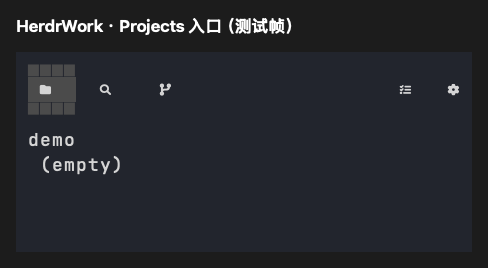
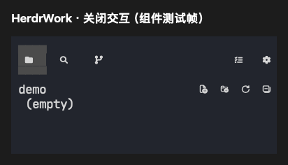

# Projects 顶部入口验证

日期：2026-10-22。平台：macOS Apple Silicon。

Explorer、搜索和 Git 顶部原 VS Code 按钮改为 Projects 任务图标入口，点击或按 Ctrl+4 打开 HerdrWork 自有看板。保留设置与文件菜单中的 VS Code 操作。



上图由 Sidebar 组件和 Ratatui TestBackend 导出，属于组件测试帧，不是宿主窗口截图。覆盖两种图标主题、三个视图和 24/28/38/80 列宽度，验证图标三行点击区域、键盘入口及侧栏视图保持。

打开请求通过现有 JobQueue 执行，连续点击合并为一个待处理请求；失败显示可重试提示，目录改变后旧结果不覆盖通知。后端沿用 Projects 的看板创建与已有看板聚焦逻辑，managed 模式只打开 `jtblink.herdr-work` 的 `board` 入口，传递产品资料目录与当前仓库。看板启动跳过独立插件的配置同步、安装提示和旧目录提示。

真实程序的私有 PTY 检查同时运行产品 UI 和 Projects 后端，以临时宿主替身捕获打开请求。验证点击、防重复、宿主拒绝后的错误反馈与重试，并断言继承的独立 Projects 配置不被修改。该检查已接入带 Projects 后端的归档安装 smoke。

## 可复现检查

```sh
cargo fmt --check
cargo test --workspace --locked
cargo test -p herdr-work-code --bin herdr-work-code-browser --features reference-ui --locked
cargo clippy -p herdr-work-code -p herdr-work-engine -p herdr-work-tui --all-targets --locked -- -D warnings
python3 -m unittest discover -s scripts/tests -v
cargo build -p herdr-work -p herdr-work-projects --locked
python3 scripts/tests/projects_entry_fixture.py target/debug/herdr-work
python3 scripts/build.py --target aarch64-apple-darwin
python3 scripts/package.py create --target aarch64-apple-darwin --output .scratch/projects-entry-package
python3 scripts/smoke.py --archives .scratch/projects-entry-package
```

workspace 540 项通过、4 项按既有配置忽略；来源界面 55 项、Python 41 项通过。本机 release 构建、归档安装/执行/卸载 smoke 通过。相关三包严格 Clippy 通过；全 workspace 严格 Clippy 在既有 Tasks data 源码报告 50 处警告，未将该检查记为通过。

本次未手工验收真实宿主窗口或执行 Linux/Windows 原生交互。

## 关闭返回后的按钮状态

2026-10-23：鼠标按下和松开不再保存为侧栏的悬停位置，Projects 点击后立即恢复普通样式；Ctrl+4 同样清除残留悬停。鼠标再次移动到按钮上时显示悬停反馈，当前 Explorer、搜索或 Git 视图的选中标识保留。

组件回归覆盖两种图标主题、三个视图、24/28/38/80 列、按钮三行点击区及键盘入口。先复现点击后背景仍为悬停色，再验证松开并返回后恢复普通背景，无需新增鼠标事件或后台查询。


