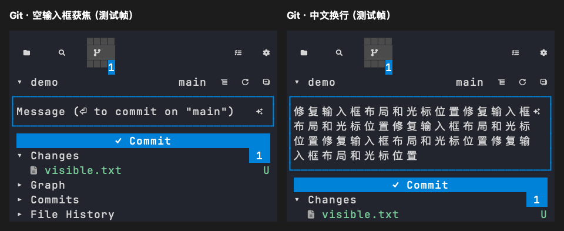

# Git 提交输入框布局

日期：2026-10-22。平台：macOS Apple Silicon。

## 原因与修正

单仓库提交框压缩高度后只绘制侧边与底边，顶部与仓库标题混在一起；空草稿获焦后隐藏提示文字，只剩光标与不完整边框。组件回归先复现缺少顶部边框的失败，再应用修正。

恢复输入框完整边框，空草稿获焦时仍显示原提示，光标停在首个输入位置。单仓库与多仓库输入框保持相同的空框提示行为。提交按钮继续占一行；移除底部提示区的一行空白，将空间留给输入框，12 行高的短窗口仍能看到文件列表。消息较长时继续使用原中文列宽换行与四行滚动窗口，光标限制在可见文本区域内。



上图由实际 Sidebar 组件和 Ratatui TestBackend 渲染，是组件测试帧，不是宿主截图。使用临时仓库与资料；截图导出使用新画布，避免 TestBackend 跳过宽字符后半格时保留旧帧内容。

## 验证

```sh
HERDR_WORK_TEST_FRAMES=<绝对输出目录> cargo test -p herdr-work-code --features sidebar-ui --test compact_scm --locked
cargo test -p herdr-work-code -p herdr-work-tui --features herdr-work-code/sidebar-ui --locked
cargo clippy -p herdr-work-code -p herdr-work-tui --all-targets --locked -- -D warnings
cargo fmt --check
python3 scripts/build.py --target aarch64-apple-darwin
python3 scripts/package.py create --target aarch64-apple-darwin --output .scratch/scm-input-package
python3 scripts/smoke.py --archives .scratch/scm-input-package
```

Code 与 TUI 测试 451 项通过、3 项按既有配置忽略；相关严格 Clippy、格式、本机 release 构建及归档安装/执行/卸载 smoke 通过。组件检查覆盖两种图标主题、24/28/38 列宽度、12/24 行高度、点击聚焦、长中文换行、光标位置与清空后恢复提示。共享多仓库组件也验证空框获焦时保留提示。

本次未手工验收真实宿主窗口，也未执行 Linux/Windows 原生交互。
