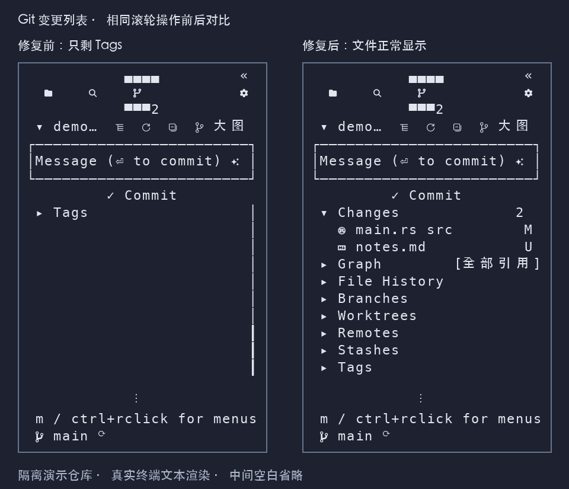

# Git 变更列表滚动边界

日期：2026-11-02。修复版本：0.1.21。平台：macOS Apple Silicon。问题：[GitHub #51](https://github.com/JTBlink/herdr-work/issues/51)。

## 复现与原因

Git 活动图标仍显示变更数量，但连续向下滚轮后，列表仅剩最后的 `Tags`，下面大片空白，`Changes` 和文件全部移出视野。0.1.20 正式程序在隔离宿主中可稳定复现。

列表只将滚动位置限制到最后一条记录，没有限制到最后一页。即使全部内容能放入窗口，滚轮仍可隐藏前面的所有行；旧滚动位置恢复和窗口变高也有同样问题。

## 修复与回归

按每行的实际高度计算最后一页起点，统一用于绘制和鼠标命中；保留键盘选择定位和超高消息框的局部显示。

- 真实 Sidebar 组件使用 13 个变更文件验证持续向下滚轮，文件仍可见。
- 覆盖 Material/Emoji、矮窗口滚动、窗口变高及过大滚动位置恢复。
- 窗口计算回归覆盖多行消息框、选择跳转、单行超过视口和空列表。
- 同一隔离宿主脚本在正式程序上失败、修复后的程序上通过；同时检查展开折叠、宽度恢复、关闭及原工作进程保留。

```sh
cargo test -p herdr-work-code --features sidebar-ui --test scm_scroll --locked
cargo test -p herdr-work-code --features sidebar-ui --lib scm_widgets::tests::list_scroll_stops_at_a_full_last_page --locked
cargo test --workspace --locked
cargo clippy --workspace --all-targets --locked -- -D warnings
cargo fmt --check
git diff --check
```

本机 workspace 595 项通过、4 项既有忽略；严格 Clippy 和格式检查通过。未执行 Linux/Windows 原生交互验收。



图片来自隔离演示仓库的真实终端文本快照，使用统一配色渲染，中间空白省略；不是桌面像素截图。没有个人目录、凭据或用户工作内容，PNG 无元数据。原始脱敏文本见 [快照](assets/scm-scroll.json)。
