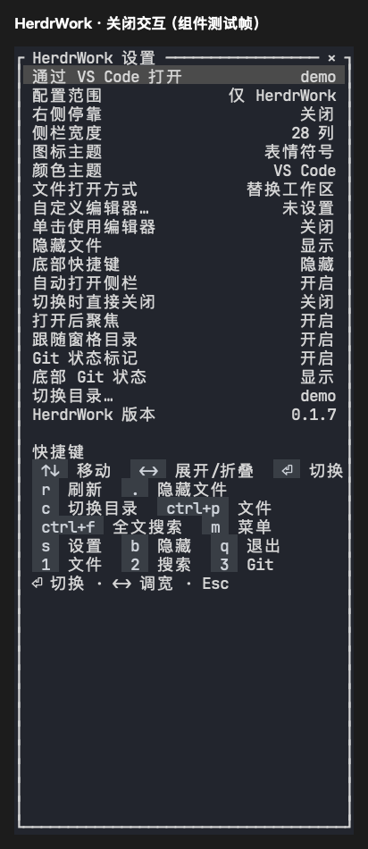

# 设置菜单覆盖侧栏

日期：2026-10-23。平台：macOS Apple Silicon。

Explorer、搜索和 Git 使用当前 Sidebar 的完整绘制区域呈现设置菜单，不再按内容宽高居中内缩。右上角三列 `×` 按钮与实际点击区域共用同一几何，点击只关闭设置并返回原视图；Esc 保持原行为。



上图由 Ratatui TestBackend 导出。自动回归覆盖 24×14、28×60、38×42、80×50 窗口，验证菜单四边与侧栏一致、右上角关闭按钮、鼠标关闭、键盘返回、目录保持和原有设置项顺序。窄窗继续使用原有滚动及中文列宽处理。

```sh
cargo test -p herdr-work-code --test settings_ui --features sidebar-ui --locked
cargo test -p herdr-work-code --all-targets --features sidebar-ui,reference-ui --locked -- --test-threads=1
cargo clippy -p herdr-work-code --all-targets --features sidebar-ui --locked -- -D warnings
cargo fmt --check
git diff --check
```

组件与来源界面检查通过；本地未执行 Linux/Windows 原生窗口手工验收。本次修改纳入 v0.1.7 的三平台构建与安装候选流程。
