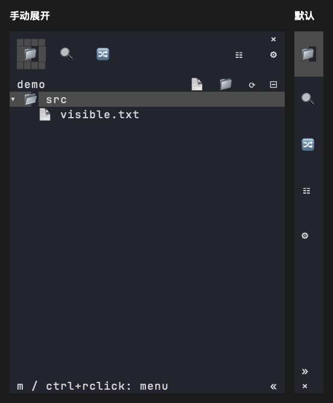

# 侧栏折叠与关闭

日期：2026-10-29。平台：macOS Apple Silicon。

## 行为

- 新建标签页或工作区的自动侧栏首帧使用折叠图标栏，不抢工作窗格焦点。显式打开文件、搜索、Git 等活动时展开到配置的正常宽度；自动 ensure 不改变已有侧栏的展开状态。
- 默认侧栏的 `«` 将正文折叠为一列图标，保留文件、搜索、Git、任务和设置入口。
- `»`、Enter 或右方向键展开原视图，保留文件树展开状态、选择和提交草稿；文件、搜索、Git 图标展开并选择对应视图。任务入口保持图标列并独立打开看板，设置入口展开设置。
- 展开时右上角、折叠时底部的 `×` 关闭整个侧栏。宿主内继续使用来源草稿保存、hide 和 snooze；无宿主时通知唯一终端循环退出。`b` 保留隐藏语义。
- 折叠内容固定为 4 个终端列：两列图标槽及左右各一列边距，不显示悬停文字。Herdr 0.9.3 的 PTY 缓冲区最少保留 4 列；此前仅按 `pane.read` 文本和窄外框判断成功，漏掉了实际视口裁剪。现按四列内容加两列外框检查可见区域和图标位置。官方宿主还有 10% 最小分栏比例，需要单独应用精确比例补丁。
- 折叠期间继续心跳和后台刷新，不将窄窗口尺寸交给来源 App 的首选宽度修复。折叠状态仅属于当前组件实例，不改写保存的正常侧栏宽度。


上图由实际 Sidebar 组件的 Ratatui TestBackend 帧导出，使用临时仓库与资料，展示 38 列展开和 4 列折叠布局；不是宿主窗口截图。

## 验证

```sh
HERDR_WORK_TEST_FRAMES=<绝对输出目录> cargo test -p herdr-work-code --features sidebar-ui --test sidebar_collapse --test settings_ui --locked
cargo test --workspace --locked
python3 -m unittest discover -s scripts/tests -v
cargo build -p herdr-work --locked
python3 scripts/docking_smoke.py --binary target/debug/herdr-work --output <绝对输出目录>
cargo fmt --check
git diff --check
```

组件回归覆盖 Emoji/Material、左右停靠、Explorer/Search/Git、图标点击、任务请求、展开设置、原视图保持，以及提交输入获焦时折叠与草稿保留。关闭测试覆盖无宿主终端退出；私有 Herdr 测试实际点击 `«`、`»` 和 `×`，验证宽度恢复、折叠跨布局恢复定时器保持、关闭成功与原工作分栏树恢复。

私有宿主 8 组场景通过：左右停靠、上下分栏、嵌套分栏、已有侧栏，以及显式激活和静默 ensure。Python unittest 41 项通过。本机开发构建、格式及 diff 空白检查通过。测试不连接用户宿主会话。

未执行 Linux/Windows 原生交互或人工操作验收。

`0.1.10` 修复后根 workspace 回归：570 项通过、4 项按既有配置忽略；Python unittest 41 项通过；严格 Clippy、格式和空白检查通过。

已增加[宿主精确比例补丁](../patches/herdr/README.md)。私有会话测试显式开启双边框，验证折叠后外框 6 列、可见内容 4 列，五个 Material 图标均位于内容区第 2 列，并在外层窗口变化后保持。组件测试同时验证 Emoji/Material 图标完整保留及左右边距。普通侧栏重装不会改变旧宿主的比例限制。

## 新标签页默认折叠回归

`docking_smoke.py --exact-rail` 增加新建自动侧栏场景，覆盖左右停靠和嵌套分栏；检查默认图标栏、四列可见内容、工作焦点保留、显式活动复用同一侧栏并展开，以及后续折叠和关闭。组件回归覆盖 Emoji/Material 与 Explorer/Search/Git 初始活动。



上图使用实际组件的自动启动折叠帧和展开帧，资料为临时测试仓库；不是桌面宿主截图。

2026-10-30 本地验证：根 workspace 570 项通过、4 项既有忽略；参考 UI 56 项、Python unittest 41 项通过；严格 Clippy、格式与 diff 空白检查通过。私有宿主覆盖 12 组停靠场景，其中 4 组验证新建自动侧栏默认折叠及显式活动展开。
