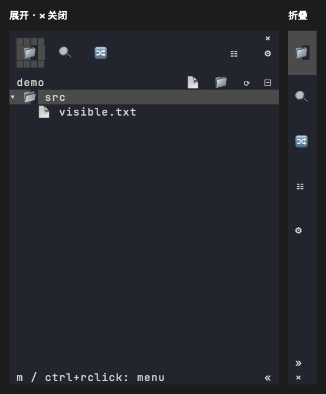
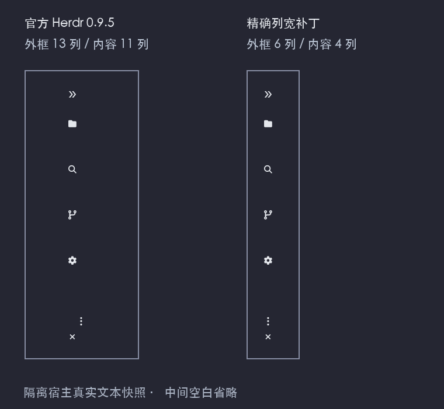

# 侧栏折叠与关闭

日期：2026-10-29。平台：macOS Apple Silicon。

## 行为

- 新建标签页或工作区的自动侧栏首帧使用折叠图标栏，不抢工作窗格焦点。显式打开文件、搜索、Git 等活动时展开到配置的正常宽度；自动 ensure 不改变已有侧栏的展开状态。
- 默认侧栏的 `«` 将正文折叠为一列图标，保留文件、搜索、Git 和设置入口。
- `»`、Enter 或右方向键展开原视图，保留文件树展开状态、选择和提交草稿；文件、搜索、Git 图标展开并选择对应视图。设置入口展开设置。
- 折叠后底部的 `×` 或 `b` 关闭整个侧栏。宿主内继续使用来源草稿保存、hide 和 snooze；无宿主时通知唯一终端循环退出。`b` 保留隐藏语义。
- 折叠内容固定为 1 个终端列，无左右边距；双边框宿主另占 2 列。Herdr 的 PTY 缓冲区最少 4 列，因此图标和命中区固定在首列，不能按 PTY 宽度居中。Emoji 主题的宽图标使用单列文本符号，展开后保留配置的主题。官方宿主的 10% 最小分栏比例仍需单独应用精确比例补丁。
- 折叠期间继续心跳和后台刷新，不将窄窗口尺寸交给来源 App 的首选宽度修复。折叠状态仅属于当前组件实例，不改写保存的正常侧栏宽度。



上图为 0.1.18 之前的四列布局基线，由实际 Sidebar 组件的 Ratatui TestBackend 帧导出，使用临时仓库与资料，展示 38 列展开和 4 列折叠布局；不是宿主窗口截图。

## 验证

```sh
HERDR_WORK_TEST_FRAMES=<绝对输出目录> cargo test -p herdr-work-code --features sidebar-ui --test sidebar_collapse --test settings_ui --locked
cargo test --workspace --locked
python3 -m unittest discover -s scripts/tests -v
cargo build -p herdr-work --locked
python3 scripts/docking_smoke.py --binary target/debug/herdr-work --output <绝对输出目录>
cargo fmt --check
git diff --check
```

组件回归覆盖 Emoji/Material、左右停靠、Explorer/Search/Git、图标点击、展开设置、原视图保持，以及提交输入获焦时折叠与草稿保留。关闭测试覆盖无宿主终端退出；私有 Herdr 测试实际点击 `«`、`»` 和 `×`，验证宽度恢复、折叠跨布局恢复定时器保持、关闭成功与原工作分栏树恢复。

私有宿主 8 组场景通过：左右停靠、上下分栏、嵌套分栏、已有侧栏，以及显式激活和静默 ensure。Python unittest 41 项通过。本机开发构建、格式及 diff 空白检查通过。测试不连接用户宿主会话。

未执行 Linux/Windows 原生交互或人工操作验收。

`0.1.10` 修复后根 workspace 回归：570 项通过、4 项按既有配置忽略；Python unittest 41 项通过；严格 Clippy、格式和空白检查通过。

已增加[宿主精确比例补丁](../patches/herdr/README.md)。私有会话测试显式开启双边框，验证折叠后外框 6 列、可见内容 4 列，五个 Material 图标均位于内容区第 2 列，并在外层窗口变化后保持。组件测试同时验证 Emoji/Material 图标完整保留及左右边距。普通侧栏重装不会改变旧宿主的比例限制。

## 新标签页默认折叠回归

`docking_smoke.py --exact-rail` 增加新建自动侧栏场景，覆盖左右停靠和嵌套分栏；检查默认图标栏、四列可见内容、工作焦点保留、显式活动复用同一侧栏并展开，以及后续折叠和关闭。组件回归覆盖 Emoji/Material 与 Explorer/Search/Git 初始活动。


上图为 0.1.18 之前的四列布局基线，使用实际组件的自动启动折叠帧和展开帧，资料为临时测试仓库；不是桌面宿主截图。

2026-10-30 本地验证：根 workspace 570 项通过、4 项既有忽略；参考 UI 56 项、Python unittest 41 项通过；严格 Clippy、格式与 diff 空白检查通过。私有宿主覆盖 12 组停靠场景，其中 4 组验证新建自动侧栏默认折叠及显式活动展开。


## 0.9.5 精确宽度复核（2026-11-02）

官方宿主仍将折叠栏限制为至少 10%，在私有会话中实际得到 13 列外框。适配后的[0.9.5 精确比例补丁](../patches/herdr/precise-split-ratio-v0.9.5.patch)在 12 组真实宿主场景中保持 4 列内容、双边框外框 6 列；窗口从 160 列变为 200 列后宽度不变。临时工作进程、原分栏树和焦点检查通过。

布局单元测试 29 项通过、1 项既有忽略；Code 折叠组件回归和 Python 61 项通过。补丁只在隔离测试版宿主验证，当前运行的用户宿主尚未切换。



## 一列折叠栏（0.1.18，2026-11-02）

图标栏从四列内容压缩为一列，取消两侧边距。组件回归同时检查一列终端和四列 PTY：文件、搜索、Git、设置、展开与关闭按钮都位于第一列，右侧空白不参与点击；覆盖两种图标主题、左右停靠和视图/提交草稿恢复。

实际宽度对比见上图：隔离宿主的布局与文本快照按等宽网格渲染，外框为 3 列、可见内容为 1 列，不包含用户资料。

使用同一 0.9.5 补丁宿主的 12 组隔离场景全部通过，实测外框 3 列、内容 1 列；覆盖自动启动、显式打开、左右与嵌套停靠、已有侧栏复用、160/200 列窗口变化、展开恢复和关闭。当前用户宿主仍未切换。

本地验证：根 workspace 592 项通过、4 项既有忽略；Python unittest 61 项通过；严格 Clippy、格式和差异空白检查通过。macOS release 构建、归档校验及隔离安装/执行/卸载检查通过；Linux/Windows 由本版本候选流水线验证。
