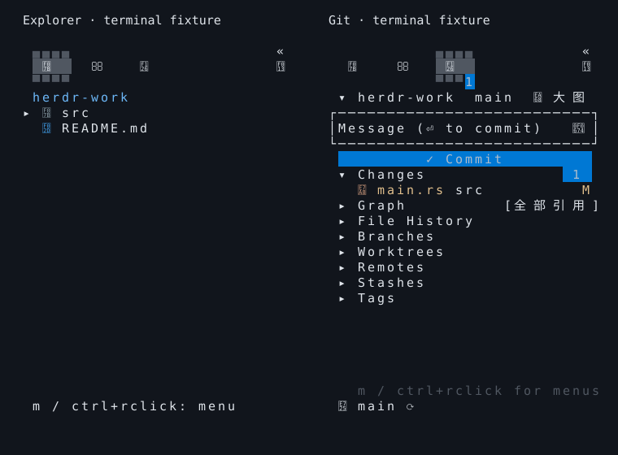

# 任务后端移除验证

日期：2026-11-01。当前产品范围见 [ADR-0003](../adr/0003-remove-task-backend.md)。

- 默认 Sidebar 的 Explorer / Git 顶栏只保留文件、搜索、Git 与设置，折叠栏同步移除任务入口，设置上移。
- 完整工作台保留文件、搜索、Git 与审查，数字 1/2/3/4 与导航提示一致。
- CLI 不再接受任务命令、调度命令、后端路径和任务执行选择参数；`reconcile` 直接读取 Git 操作日志。
- 各平台归档只允许主程序，保留 Sidebar 与进程运行器许可证。旧版自有后端只在安装收据清理和回滚中识别，用户资料及独立插件保留。

下面为真实 `Sidebar` 组件经 Ratatui TestBackend 绘制并导出的终端帧，使用临时仓库与测试数据；不是用户宿主会话的人工截图。



复现：

```sh
cargo test --workspace --locked
cargo clippy --workspace --all-targets --locked -- -D warnings
cargo test -p herdr-work-code --features reference-ui --bin herdr-work-code-browser --locked
python3 -m unittest discover -s scripts/tests -v
python3 scripts/build.py --target aarch64-apple-darwin
python3 scripts/package.py create --target aarch64-apple-darwin
python3 scripts/smoke.py --archives dist
```

本机覆盖 macOS；Linux/Windows 构建、原生测试与安装由同一发布 SHA 的 Actions 验证。人工 Agent 会话不计为已验收。发布结果集中记录在 [#49](https://github.com/JTBlink/herdr-work/issues/49)。
