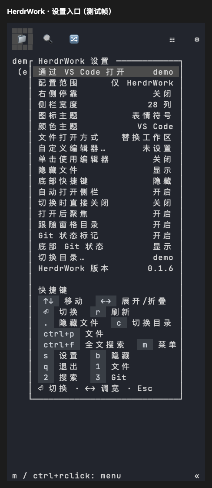

# VS Code 文件打开与设置隔离验证

日期：2026-10-21。平台：macOS Apple Silicon。

## 行为与范围

HerdrWork 设置的“文件打开方式”增加 VS Code，和新标签页、分栏、替换工作区一起循环切换。该选项作用于文件单击、Enter、Quick Open、搜索命中；搜索命中携带行号。文件与目录菜单提供一次性的“通过 VS Code 打开”，显式“预览文件”仍使用内置 viewer；Git 差异和历史沿用内置 viewer 与 takeover 恢复。

Explorer 与 Git 设置在列表第一项提供独立“通过 VS Code 打开”入口，直接打开当前项目目录，不修改默认方式。两个视图共用后台启动器，避免重复启动和旧目录结果覆盖通知。 底部临时提示显示 3 秒后自动消失，重复触发重新计时；空闲时同样生效，确认弹窗仍等待用户选择。



上图由真实产品资料下的 Sidebar 组件与 Ratatui TestBackend 渲染，属于组件测试帧，不是宿主窗口截图。可用 `HERDR_WORK_TEST_FRAMES=<绝对输出目录> cargo test -p herdr-work-code --features sidebar-ui --test settings_ui --locked` 导出原始帧。

编辑器启动使用独立参数，不拼接 shell 命令；路径规范化后完整传递，后台任务有超时和失败提示。macOS 使用 PATH 中的 `code` 或标准应用目录里的 CLI。Windows 适配使用安装目录下的 CLI 脚本，不把长时间运行的 GUI 当作可超时终止的启动器；本次未执行 Windows 原生验证。

设置显示“配置范围：仅 HerdrWork”。自有资料的 `sidebar/state.json` 是 HerdrWork 内部文件，宿主活动入口与界面使用同一个 `product_settings_path`。配置产品资料后，继承的 `HERDR_PLUGIN_STATE_DIR` 不参与设置或编辑器命令的读取、写入。独立 Sidebar 的自动打开、聚焦、主题等仍由其自己的配置决定。

## 可复现检查

```sh
cargo fmt --check
cargo test --workspace --locked
cargo clippy --workspace --all-targets --locked -- -D warnings
cargo test -p herdr-work-code --bin herdr-work-code-browser --features reference-ui --locked
python3 -m unittest discover -s scripts/tests -v
python3 scripts/tests/vscode_settings_fixture.py target/debug/herdr-work
python3 scripts/build.py --target aarch64-apple-darwin
python3 scripts/package.py create --target aarch64-apple-darwin --output .scratch/vscode-package
python3 scripts/smoke.py --archives .scratch/vscode-package
```

私有 PTY 运行实际 HerdrWork 程序，传入独立 Sidebar 的干扰配置目录，依次切换文件打开方式、自动打开、右侧停靠、快捷键显示、严格切换、聚焦、跟随目录。断言仅 HerdrWork 自有设置变化，独立配置与自定义编辑器文件逐字节不变。

测试使用临时 `code` 替身捕获实际启动参数，不打开用户的编辑器窗口；覆盖包含空格、中文和 shell 元字符的文件名、搜索第二行的 `--goto` 参数、目录菜单及启动器非零退出后的可见错误。该检查已接入 Unix 归档安装 smoke。右键菜单组件测试帧见[菜单验证](context-menu-and-preview-close.md)。

独立设置入口的真实 PTY 验证分别从 Explorer 与 Git 设置选择该行，断言 `code --reuse-window <当前项目目录>`；保留原文件打开方式和跨插件配置隔离断言。

本次 workspace 503 项通过、4 项按既有配置忽略；来源界面 54 项、Python 26 项通过；严格 Clippy、格式、release 构建与完整归档安装 smoke 通过。既有预览关闭四组合回归也通过。

未手工验收真实 VS Code 窗口；Linux/Windows 原生交互本次未执行，不以本机参数验证替代这些验收。
